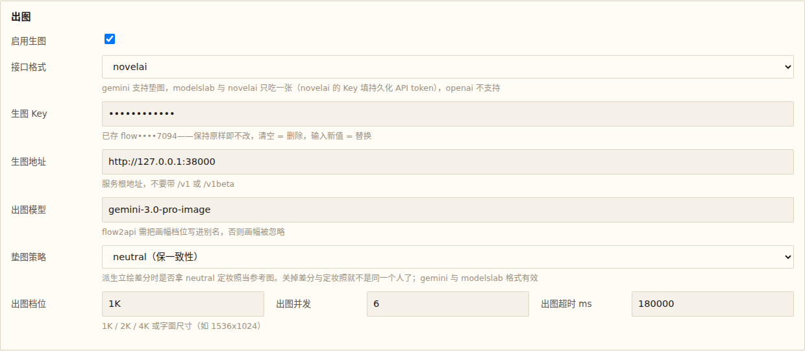

# NovelAI 生图支持 · 验证

**实机地址（本 worktree 的 dev 实例）**：https://professional-tech-whats-rand.trycloudflare.com

## 场景（看哪里、看什么）

1. **设置页认得出这一档**：打开 `/#/settings` → 「出图」组 → 「接口格式」下拉，应能看到
   第四个选项 **`novelai`**（`gemini` / `modelslab` / `novelai` / `openai`）；选中它时上方那句提示应说明
   「novelai 的 Key 填持久化 API token」。
2. **配置面自洽**（同页，不点保存也行）：把 `接口格式` 选 `novelai` 时，对照 README「设置页字段总表 → 出图」——
   `生图地址` 填 `https://image.novelai.net`（不带 `/ai`）、`出图模型` 填 `nai-diffusion-4-5-full` 这类
   NovelAI 模型 id、`生图 Key` 填 `pst-` 开头的持久化 token。**本实例的 `settings.json` 软链到主仓库，
   所以验证时请不要点保存**，直接看表单能否选中即可。

## 有 NovelAI 订阅时请顺手验这两条（本机没凭据，跑不了）

1. **1K 背景**：`格式 novelai` + 模型 `nai-diffusion-4-5-full` + 档位 `1K`，出一张背景——
   要的是 200 与一张正常图（画布 1344x768，落在 Opus 免费带内）。
2. **2K 立绘差分（垫 JPEG 原片）**：先出一个角色的 `neutral`，再派生一张差分。这条同时压三个点：
   V4.5 的 `v4_prompt` 结构成对、img2img 的源图被 `fitToCanvas` 缩放并转成 PNG（`neutral` 原片
   在盘上是 **JPEG**）、画布是 1152x2048（2K 会烧 Anlas，属预期）。

## 未覆盖（如实记录）

- **真·NovelAI 出图没有实跑**：本机没有 NovelAI 凭据（api-vault 里没有这一家），也按项目规矩不打真外部 API。
  接口契约（端点 / Bearer / 分代提示词结构 / ZIP 解包 / 画布换算 / 垫图 fit-to-canvas / 错误报文）由
  `apps/server/test/novelaiImage.test.ts` 的假 fetch 用例锁死（11 条全绿）。
- 音乐 / TTS / 演出链路不受影响（本次不触碰共享包与 `ImageRequest` 契约）。
- **DSH 侧（`dsh-aivn`）的格式面没同步**：那边的 `src/media/image.ts` 是自己的一份实现，
  本次只动了 stage-ai 这一侧；要让 DSH 也支持 NovelAI 是独立的一次改动。
