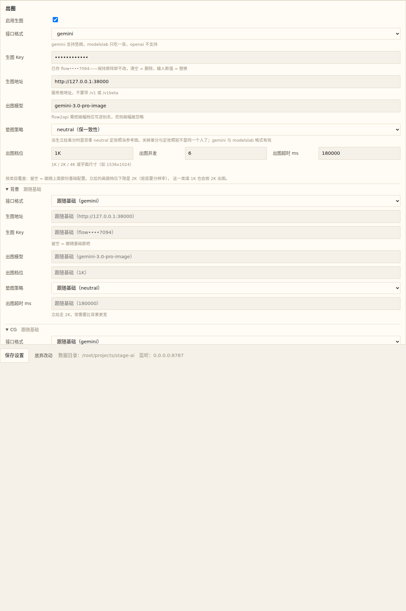
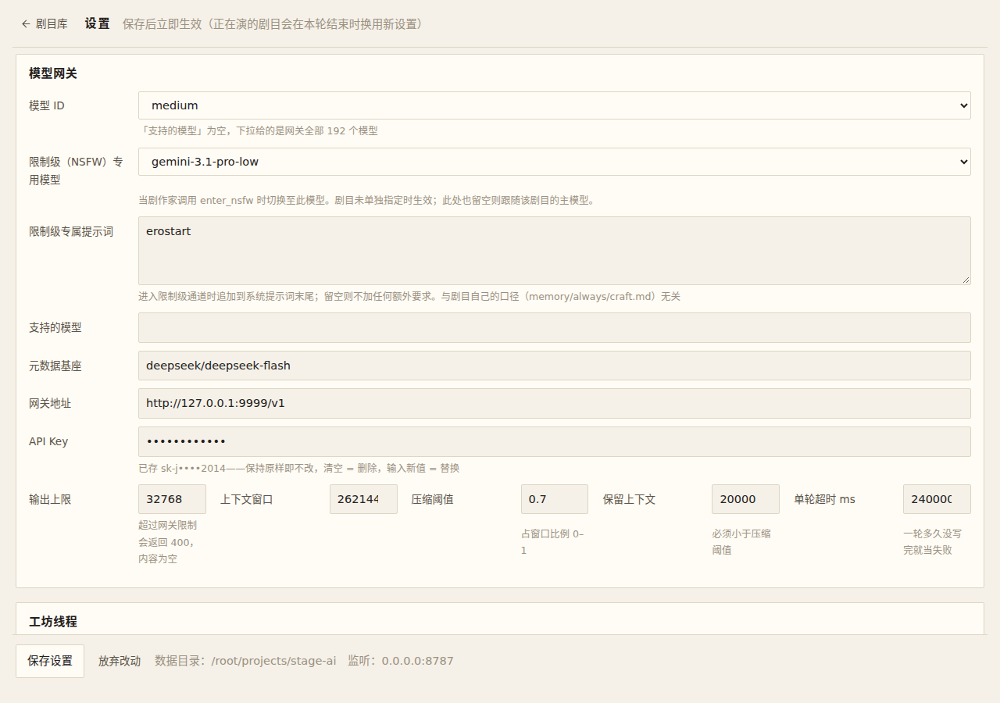
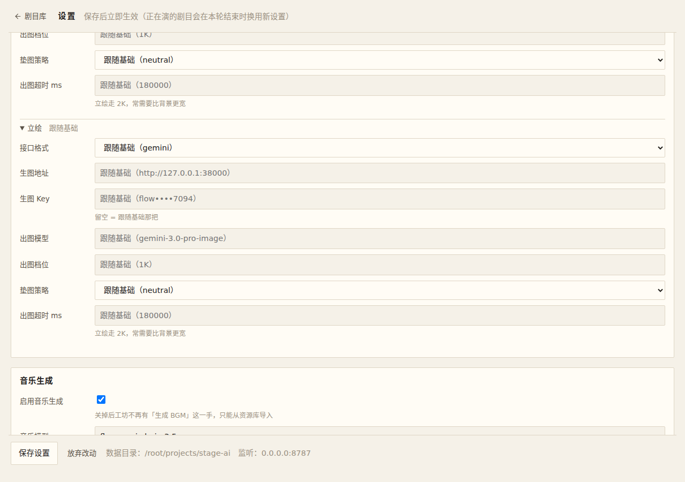

# 用户验证：生图配置按类目分开

预览地址（本机 service 已用新构建重启，密码已按你的决定留空）：<https://market-calvin-bacon-rat.trycloudflare.com/#/settings>

## 请看的 3 条

1. **出图组末尾多了三个可折叠小节**（背景 / CG / 立绘）。不展开时每行右边写「跟随基础」；展开后 7 个输入框的 placeholder 显示当前继承到的值（你这份是 `http://127.0.0.1:38000` / `flow••••7094` / `gemini-3.0-pro-image` / `1K` / `180000`）。
2. **填一个覆盖再保存**：比如给「立绘」的「出图档位」填 `2K`，保存后摘要变成「已覆盖 1 项」，`settings.json` 里出现 `image.kinds.sprite.size`；把那一格清空再保存，「已覆盖」回到「跟随基础」，文件里那一格消失。
3. **确认出图真的分流**（可选，要烧配额）：给「立绘」与「背景」填两个不同的出图地址（或不同模型），各出一张图，两张应当分别落到各自的后端。

## 现象与证据

展开态（三个小节全部展开）与折叠态：

## 结论

- 待你确认。

## 不需要验的

- `play.json` 的逐剧目 `image.model` / `image.size`（请求级覆盖）行为未变，仍作用于全部类目。
- 立绘的画面档位下限 2K 保留：这一类填 `1K` 也会按 2K 出图。
