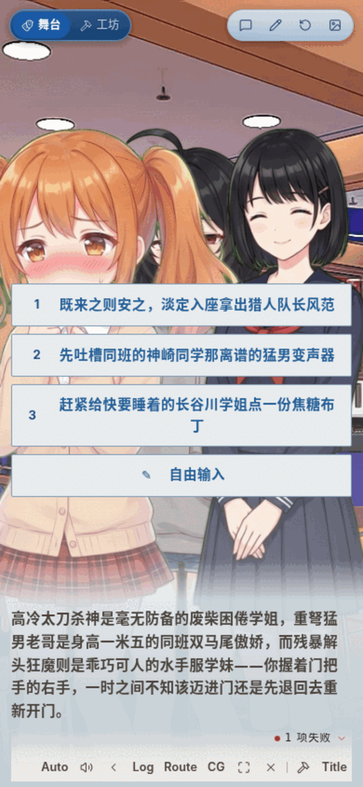
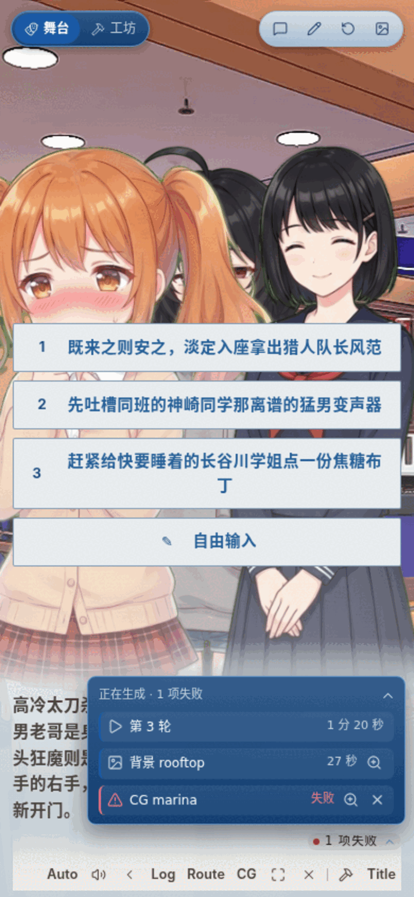
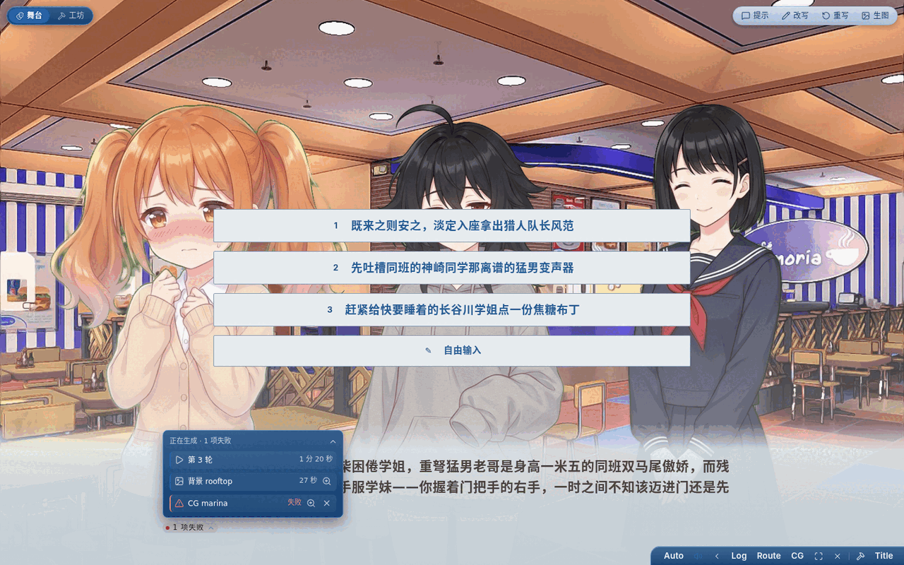
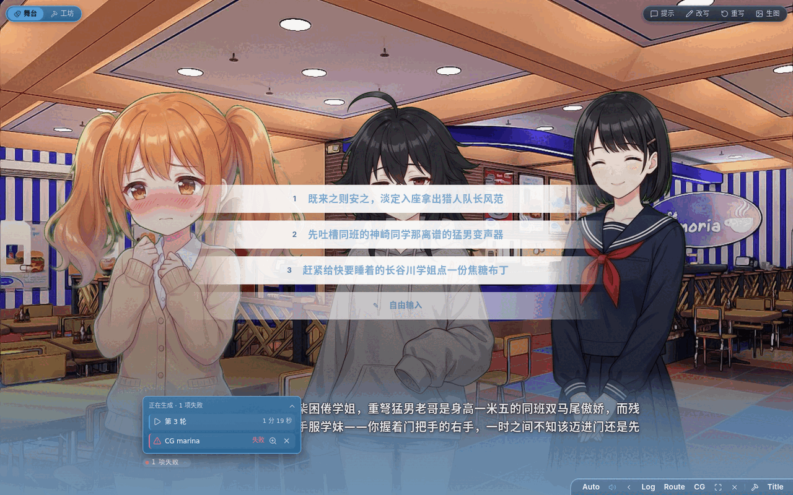

# 待注入队列落进台词条底缘 · 小结

## 做了什么

舞台那枚待注入队列徽标不再浮在画面右上角，改成**台词条底缘那格状态位**里的
一枚芯片——就是原先画 spinner「剧作家正在写」的位置；点它展开面板。

宽屏下那格在台词条底缘左侧（对齐正文左边缘，与原来的 spinner 同一处），手机上那行
本来就右对齐，于是落在右下角。这是与用户确认过的取舍：宽屏右下角被快捷菜单胶囊占着，
硬塞过去两边都挤；「没明确要求的视觉不顺手改」也是既有约定。

## 怎么落的

- `packages/stage` 新增可选 prop `dialogStatus?: ReactNode`，在 `.dialog-hint-foot` 里**顶掉**
  内置 spinner。宿主给了就画宿主的（那枚自己就报在忙什么，而且点得开），没给就还是 spinner ——
  `dsh-aivn` 那条线手里没有待注入队列，照旧。
- `PromptQueuePanel` 的舞台形态换成 `variant="dialog"`：芯片跟着台词条那行排，
  展开的面板 `portal` 到 body + `position: fixed`，锚点由芯片的实测矩形写进
  `--chip-x` / `--chip-y`（`resize` 与任意一层 `scroll` 都重量）。
  走 portal 是因为台词条在窄屏是 `overflow-y: auto` 的滚动区会把它裁掉，而且它自成一层
  层叠上下文（z-index 12），留在里面压不过舞台顶部那几条 chrome。
- 工坊那一路（`variant="dock"`）不动，还是贴内容区底部一条。
- 舞台右上角那枚浮层徽标整块撤掉，这就是「完全融入」。

台词条整条是「点一下就翻句」的热区，所以芯片的 click 里 `stopPropagation`——
开面板不能顺带把那句翻过去。

## 检视意见与处置

首次检视（报告见 `261012-pending-in-message-box.review.md`）判「不准入」，两条阻塞，都已修：

- **B1 空队列时 spinner 被顶掉**：宿主原来无条件传一个 `<PromptQueuePanel/>` 元素，
  而「元素非空」不等于「里头的有东西可报」——它渲染 `null` 时 `dialogStatus` 仍是真值，
  那格状态位就空着了。改成 `PromptQueuePanel` 导出判据 `hasPendingWork(items, jobs)`，
  宿主按它决定传组件还是 `null`，`StageTheater` 那边 `null` 照旧落回 spinner。
- **B2 面板里的点击会冒到舞台**：`createPortal` 只换 DOM 落点，React 事件照旧沿逻辑树
  冒到 `.theater` 的 `onStageClick` / `onTouchEnd`——面板里的收起、改、删都会顺带把那句
  翻过去。改成在面板根上一并掐掉 `click` 与 `touchstart` / `touchend`（比每个键各写一遍可靠）。

建议项也顺手处理了两条：锚点只在位置真的变了才写 state（滚动是高频事件）；摘要那格补
`min-width: 0`（跟快捷菜单同排一行时得肯让位）。

复检（同一份报告已覆盖写）判「条件准入」，无阻塞。它提的两条建议这样收的：

- 锚点定位补了单测：给触发器一个可控矩形，断言 `--chip-x` 取左沿、`--chip-y` 是「离屏幕底
  的距离」，并在 `resize` 后断言重量。「靠右时面板左边界受视口约束」那半条在 CSS 的
  `min()` 里，jsdom 验不了，没写。
- 键盘焦点：芯片吃的是 `stage.css` 里那条共享规则（`.stage-root :focus-visible`），
  真浏览器里 Tab 到它实测是 1px 主题色环 + 2px offset，不需要另配样式。

## 验证

- `pnpm -r build`、`pnpm typecheck`、`pnpm --filter @aivn/stage test`（62 例）、web 侧受影响的
  7 个用例文件（pendingPanel / stageHostExtras / modalScrim / playerReceipt / routeControls /
  spriteLayering / stageKeyboard，共 37 例）全绿。
- 实拍：手机与宽屏、收起与展开、深色与浅色两套主题各一张（见上），
  另外单独跑过工坊 dock 形态确认没回归；B2 在真浏览器里复验过一遍
  （点面板里的展开详情 / 收起 / 面板空白处，台词条那句不动）。
- `scripts/audit-ui.mjs` 与主工作区基线逐条对比：没有新增问题
  （主工作区多出来的那条 `ghost-btn` 小目标来自另一条在飞的改动，与本笔无关）。
- 跨宿主：`packages/stage` 的改动是**纯新增可选 prop**，`dsh-aivn` 不传就仍是 spinner，
  构造上不会坏；`dsh-aivn` 仓当时有另一路在飞的改动（`src/client/stage-view.tsx` 与
  `lib/` 都是脏的），没有去跑它的构建以免覆盖别人的产物——它吃的是主工作区那份
  `@aivn/stage`，本次合并进主分支后它下次重建才会带上这份改动。
