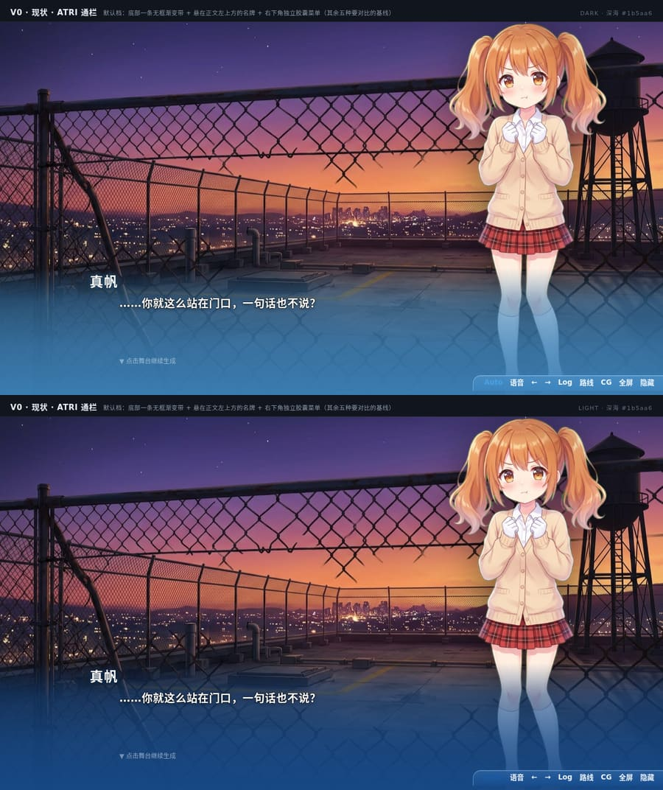
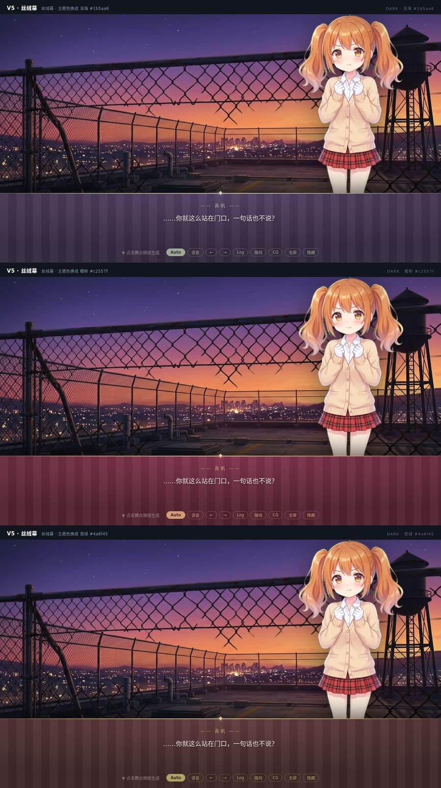
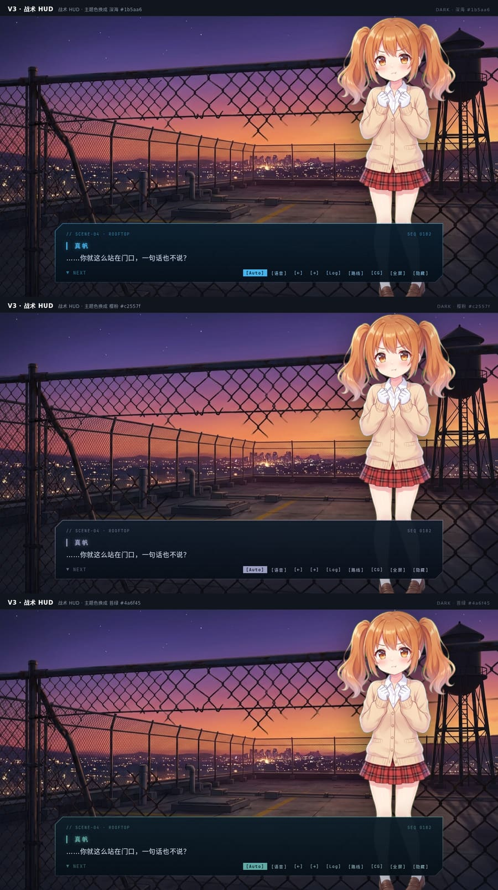
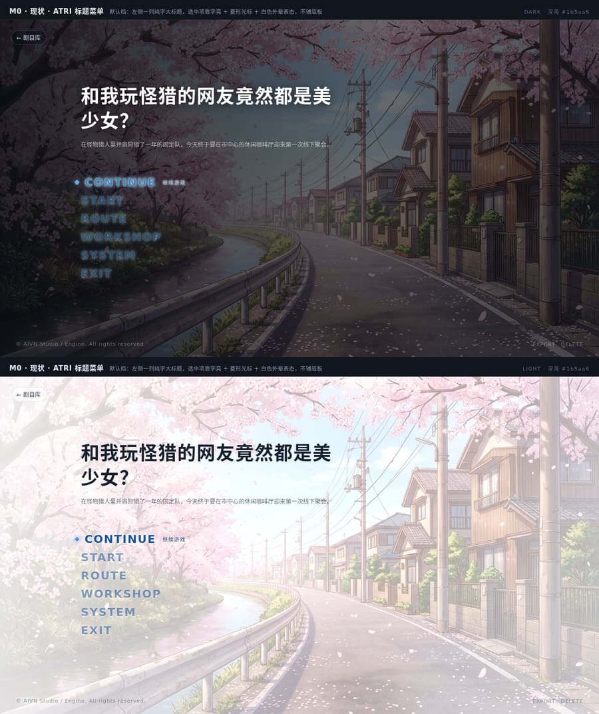
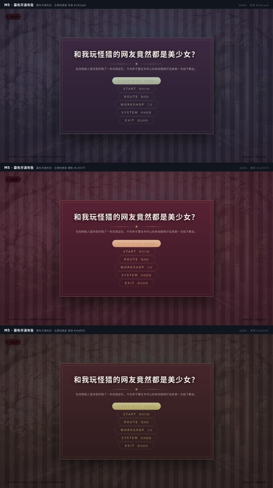

# 舞台消息框与开始菜单：六种设计方向（含现状基线）

起因是一句话：**消息框想换风格**。所以先不接开关，把「换过去会是什么样」摆出来——
同一张画面、同一句台词（或同一个剧名与同六个入口），只有这一块 UI 不同。每张图上半深色、下半浅色。

三条已定的口径：

1. **消息框与开始菜单是一组一起配的**，不是两个独立选项；
2. **现在的 ATRI 也是选项之一**（它就是「不挂任何风格」的默认档），不是被替换掉的旧版；
3. **每一套风格都要呼应剧目主题色**——`plays/<id>/theme.css` 里换个色，十种风格全都跟着走。

## 一、消息框

### V0 · 现状 · ATRI 通栏（默认档）
底部一条无框渐变带 + 悬在正文左上方的名牌 + 右下角独立胶囊菜单。其余五种都要跟它比。



### V1 · 浮岛玻璃卡
悬浮圆角卡：毛玻璃 + 上缘一道高光细线；名牌骑在卡沿上；快捷入口收在卡内底缘。
画面细节不被压掉，适合通用现代 AVG。


### V2 · 电影字幕
去掉底板，上下压成宽银幕黑边，台词大字号居中，名牌是细字距小字，快捷入口退成字幕下方一行细字。
适合文艺、悬疑、以氛围为主的戏。


### V3 · 战术 HUD
切角面板 + 扫描纹，顶上一行等宽标签（场景与序号），按键带方括号。
适合科幻、赛博、调查推理。


### V4 · 书卷
双线内框 + 衬线正文，`❖` 起头的小字距名牌，快捷入口是一行文字而不是按钮；深色是夜色纸、浅色是宣纸。
适合古风、奇幻、文学改编。


### V5 · 丝绒幕
幕布式通栏（丝绒织纹 + 金色上缘线与菱形坠），台词居中收窄，金色胶囊按键。
适合哥特、歌剧、暗黑悬疑。


## 二、主题色回声

同一套风格、三档主题色（深海 / 樱粉 / 苔绿）。材质色也掺主题色——不然换部剧还是「另一部剧的皮肤」。
丝绒幕（深酒红 + 金）与战术 HUD（深蓝 + 青）是最难跟着走的两种，拿它们作证：





## 三、开始菜单

标题画面在代码里是这个结构（`apps/web/src/views/TitleView.tsx`）：左上「剧目库」返回、
剧名 + 一行剧情简介、`.atri-menu`（CONTINUE 继续游戏 / START 新的开始 / ROUTE 路线树 /
WORKSHOP 工坊 / SYSTEM 系统配置 / EXIT 退出游戏，每项是大写英文 + 中文副标）、
底边一行版权与 EXPORT / DELETE。原型照这一套摆，接过去不用重排 markup。

### M0 · 现状 · ATRI 标题菜单（默认档）
左侧一列纯字大标题，选中项靠字亮 + 菱形光标 + 白色外晕表态，不铺底板。



### M1 · 玻璃卡菜单（配 V1）
左侧剧名与简介，右侧一张竖排玻璃卡；选中项是主题色胶囊。


### M2 · 宽银幕字幕菜单（配 V2）
剧名居中压在画面上、下面一条金线；菜单落进下方那条黑带里，浅色下黑带翻成白场。
与 V2 的消息框是同一条规矩——字住在黑边里，不住在画面上。


### M3 · 战术 HUD 菜单（配 V3）
左边等宽剧名加 `// PLAY-INFO` 标签，右边切角面板带序号，整屏压一层扫描纹。


### M4 · 书卷目录（配 V4）
竖排衬线剧名 + 朱红小印，右侧一列细线分隔的目录，选中项左边一枚朱红方块，整屏套一层双线画框。


### M5 · 幕布开演布告（配 V5）
中央一块金色双线告示板，剧名下是菱形坠饰，菜单是金色胶囊；浅色下丝绒换成暖米织纹。


三档主题色下的幕布（证明菜单也跟着走）：



## 四、和现状的关系

现状的消息框是 ATRI 通栏渐变，现状的标题菜单是 `.atri-menu` 一列纯字。五种里三种是通栏的近亲
（V1 / V3 / V5 仍是「底部一条带」），两种换了骨架（V2 去底板、V4 换卡片材质）。真正要选的是三件事：

1. **要不要底板**——V2 完全不要；其余都要，只是材质不同。
2. **快捷入口摆哪**——V1 / V3 / V5 在面板内底缘，V2 在字幕下方居中，V4 退化成一行文字。
3. **名牌怎么站**——胶囊（V1）、细字距小字（V2 / V4）、等宽标签（V3）、金色短横（V5）。

## 五、重渲染

画面取自本机数据目录（`library/backgrounds/`、`plays/mh/assets/sprites/`），这两处都不进 git，
换机器前先改两份 html 里的 `url()`。每块原型都带 `data-accent`，改它就能看同一套风格在不同主题色下的样子。

```bash
node docs/features/261012-stage-style-variants/render.mjs
# → tmp/style-variant-shots/{,title-}{combo-*,all-*,sweep-*}*.png
```

## 六、接通时怎么接（后话，现在不动生产样式）

- **一个风格 id 同时决定消息框与开始菜单**（成对选择）：`html[data-dialog-style="velvet"]` 与
  `html[data-menu-style="velvet"]` 同进同出；不写这两个属性 = ATRI 默认档。
  消息框那一半已有生产实现（`packages/stage/src/stage.css` 末尾那一节），开始菜单那一半待接。
- 开关进 `settings.json`（与界面主题走同一套读写路径），剧目可覆盖。
- 类名在十种里通用（`.dialog-name` / `.dialog-text` / `.dialog-foot` / `.quick-btn`；
  `.atri-item` / `.atri-label` / `.atri-sub`），只换 CSS 就能整条换过去；只有 V2 要两条黑边元素、
  V4 要内框、M4 要画框与小印，这几处才需要碰 markup（生产实现里用 `::before/::after` 顶掉了）。
- 工坊 agent 自己写皮肤的手艺在技能库 `galgame-ui-style` 里（`apps/server/skills/galgame-ui-style/SKILL.md`）。
