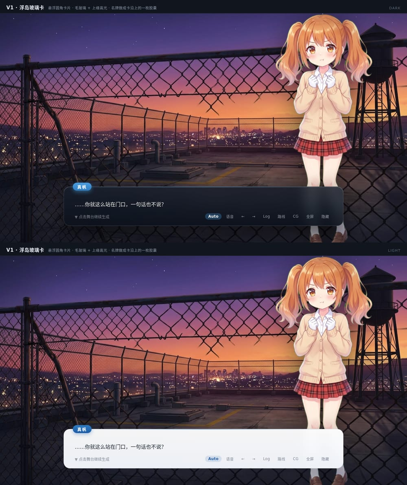
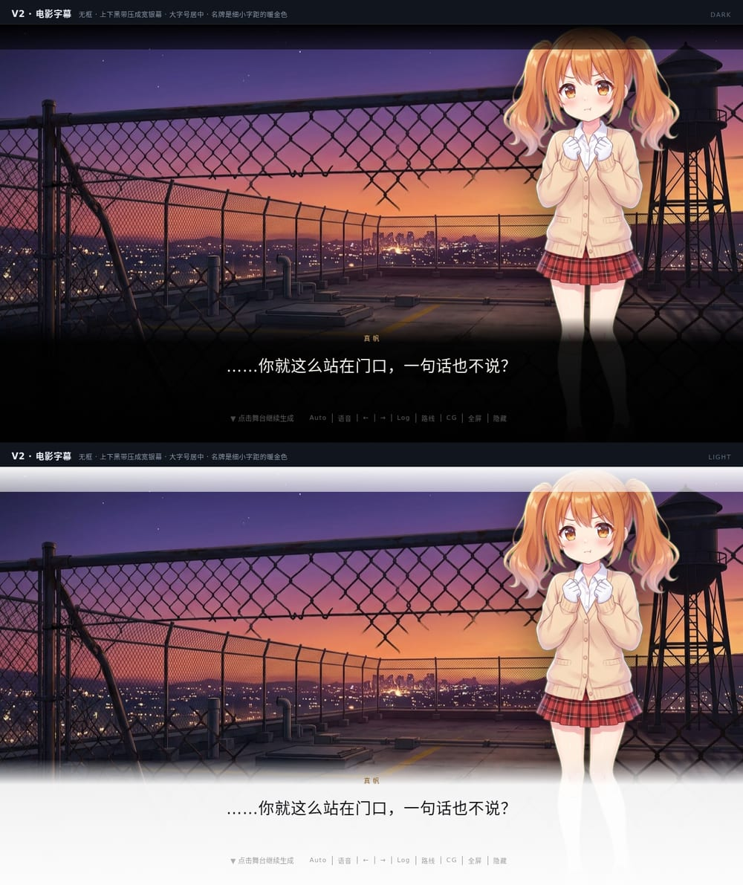
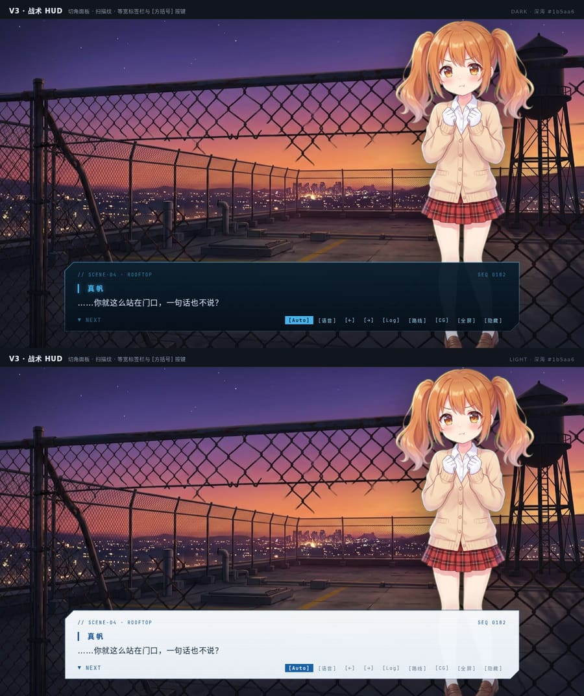
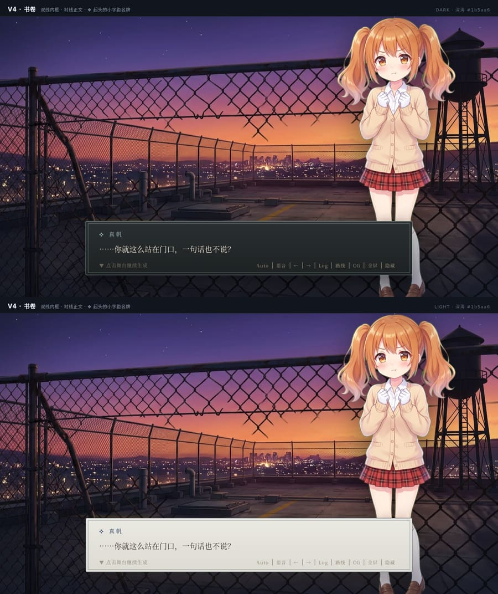
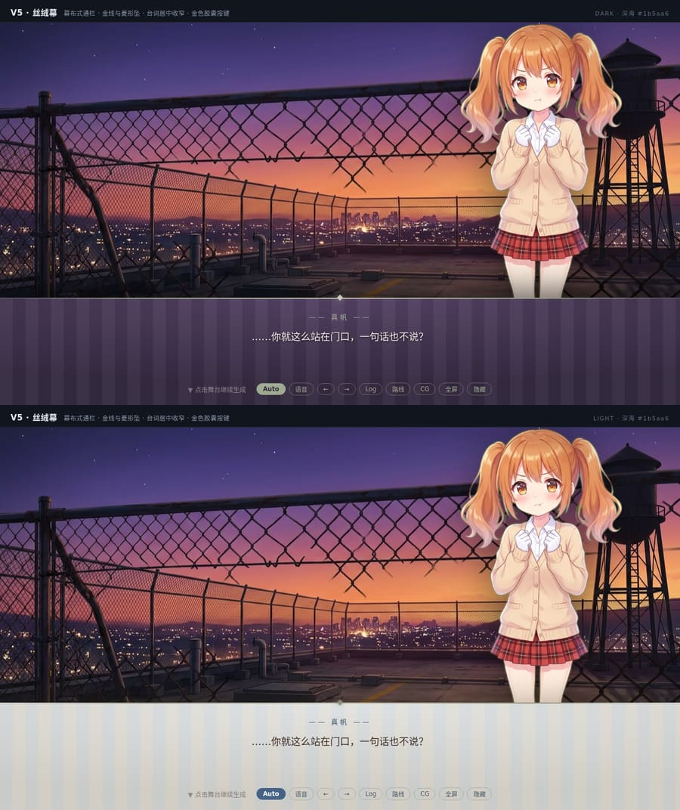
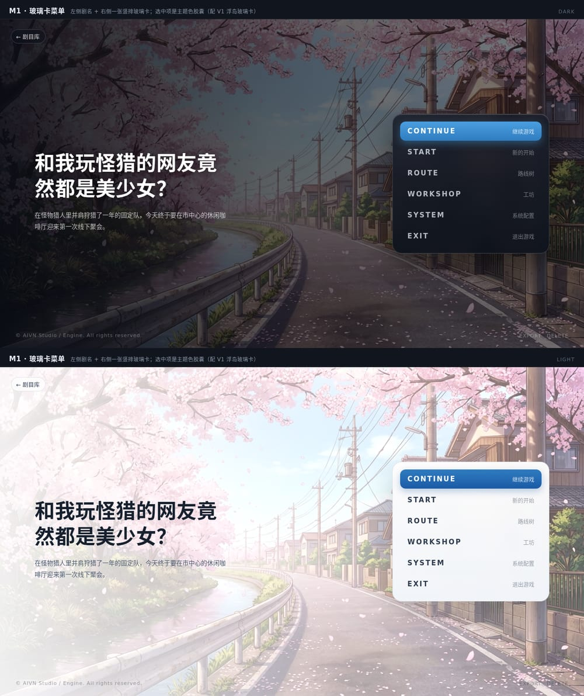
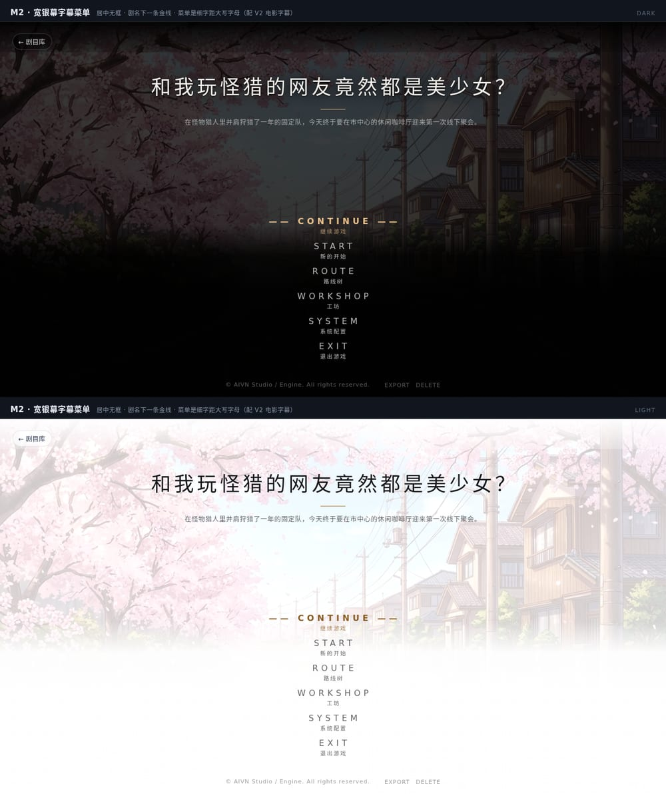
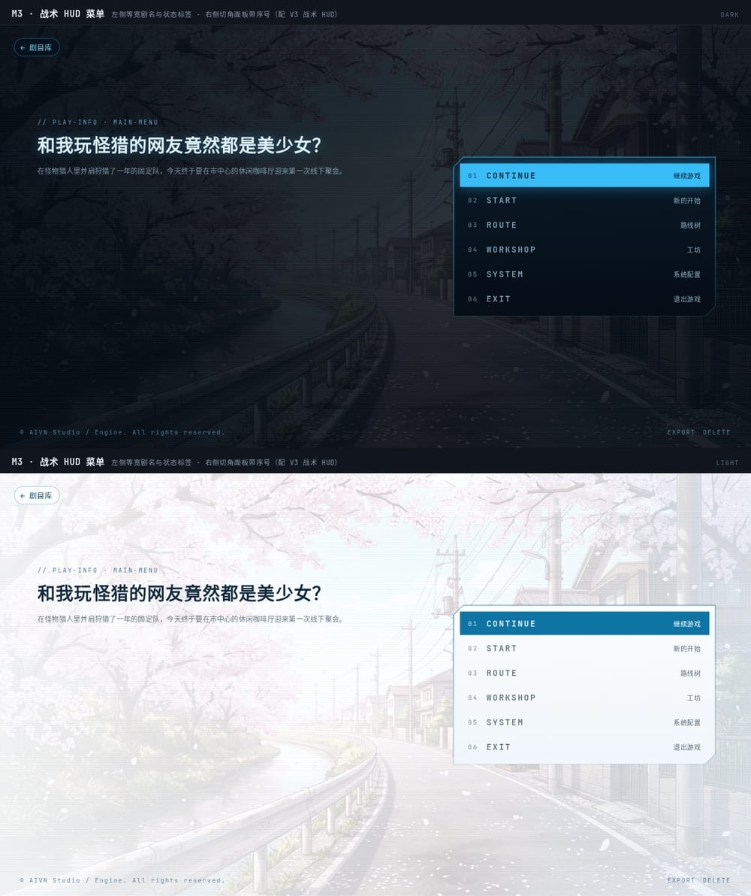
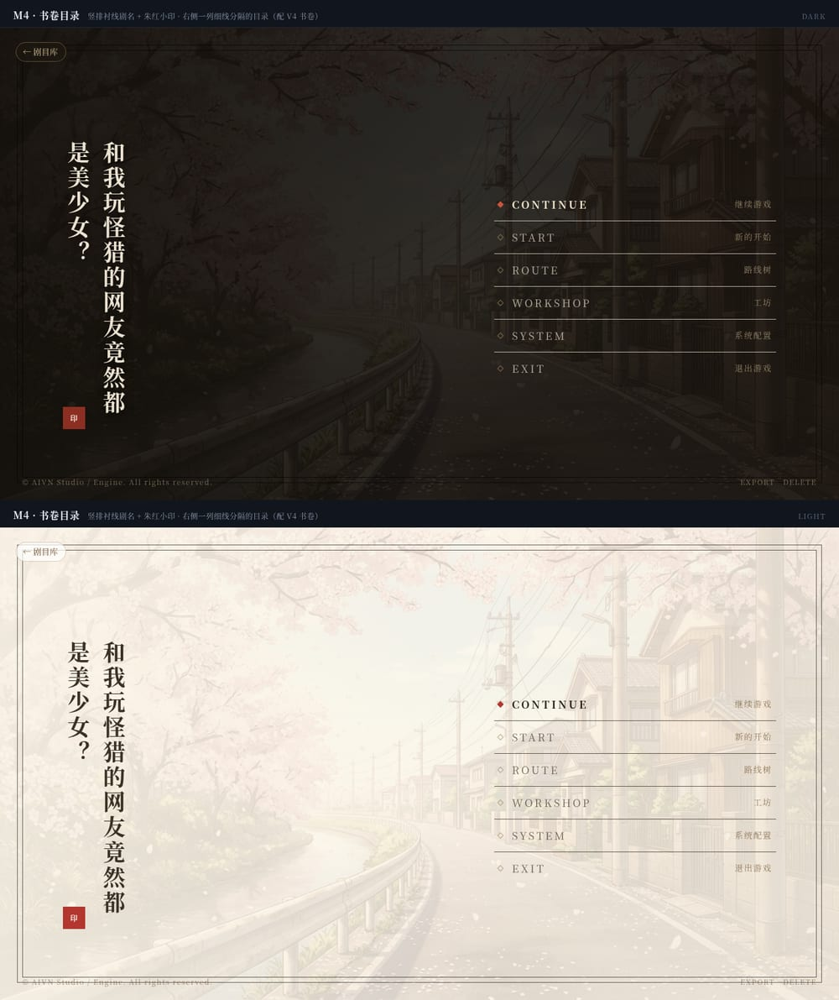
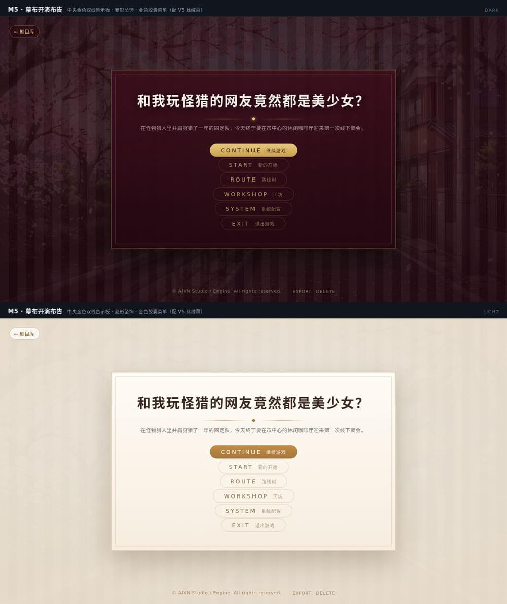

# 舞台消息框与开始菜单：五种设计方向（远景）

起因是一句话：**消息框想换风格**。所以先不接开关，把「换过去会是什么样」摆出来——
同一张画面、同一句台词（或同一个剧名与同六个入口），只有这一块 UI 不同。每张图上半深色、下半浅色。

## 一、消息框

### V1 · 浮岛玻璃卡
通栏换成一张悬浮圆角卡：毛玻璃 + 上缘一道高光细线；名牌做成卡沿上的一枚胶囊；快捷入口收在卡内底缘。
画面细节不被压掉，适合通用现代 AVG。



### V2 · 电影字幕
去掉底板，上下压成宽银幕黑边，台词大字号居中，名牌是细字距的暖金小字，快捷入口退成字幕下方一行细字。
适合文艺、悬疑、以氛围为主的戏。



### V3 · 战术 HUD
切角面板 + 青色描边 + 扫描纹，顶上一行等宽标签（场景与序号），按键带方括号。
适合科幻、赛博、调查推理。



### V4 · 书卷
双线内框 + 衬线正文，`❖` 起头的小字距名牌，快捷入口是一行文字而不是按钮；深色是夜色纸、浅色是宣纸。
适合古风、奇幻、文学改编。



### V5 · 丝绒幕
幕布式通栏（丝绒织纹 + 金色上缘线与菱形坠），台词居中收窄，金色胶囊按键；浅色下丝绒换成暖米织纹。
适合哥特、歌剧、暗黑悬疑。



## 二、开始菜单

标题画面在代码里是这一个结构（`apps/web/src/views/TitleView.tsx`）：左上「剧目库」返回、
左侧剧名 + 一行剧情简介、右侧或居中的 `.atri-menu`（CONTINUE 继续游戏 / START 新的开始 /
ROUTE 路线树 / WORKSHOP 工坊 / SYSTEM 系统配置 / EXIT 退出游戏，每项是大写英文 + 中文副标），
底边一行版权与 EXPORT / DELETE。原型照这一套摆，所以接过去时 markup 不用重排。

### M1 · 玻璃卡菜单（配 V1）
左侧剧名与简介，右侧一张竖排玻璃卡；选中项是主题色胶囊。



### M2 · 宽银幕字幕菜单（配 V2）
剧名居中压在画面上（下一条金线），菜单落进下方那条黑带里；浅色下黑带翻成白场。
与 V2 的消息框是同一条规矩——字住在黑边里，不住在画面上。



### M3 · 战术 HUD 菜单（配 V3）
左侧等宽剧名 + `// PLAY-INFO` 标签，右侧切角面板带序号与中文副标，整屏压一层扫描纹。



### M4 · 书卷目录（配 V4）
竖排衬线剧名 + 朱红小印，右侧一列细线分隔的目录，选中项左侧一枚朱红方块；整屏套一层双线画框。



### M5 · 幕布开演布告（配 V5）
中央一块金色双线告示板，剧名下是菱形坠饰，菜单是金色胶囊；浅色下丝绒换成暖米织纹。



## 三、和现状的关系

现状的消息框是 ATRI 式通栏渐变（底部一条无框渐变带，名牌悬在正文左上方，快捷菜单是右下角独立胶囊）；
现状的标题菜单是 `.atri-menu` 一列纯字（无底板，靠字亮与外晕表态）。

五种里三种是通栏的近亲（V1 / V3 / V5 仍是「底部一条带」），两种换了骨架（V2 去底板、V4 换卡片材质）。
真正要选的是三件事：

1. **要不要底板**——V2 完全不要；其余都要，只是材质不同。
2. **快捷入口摆哪**——V1 / V3 / V5 在面板内底缘，V2 在字幕下方居中，V4 退化成一行文字。
3. **名牌怎么站**——胶囊（V1）、细字距小字（V2 / V4）、等宽标签（V3）、金色短横（V5）。

## 四、重渲染

画面取自本机数据目录（`library/backgrounds/`、`plays/mh/assets/sprites/`），这两处都不进 git，
换机器前先改两份 html 里的 `url()`。

```bash
node docs/features/261012-stage-style-variants/render.mjs
# → tmp/style-variant-shots/{,title-}{combo-vN,all-dark,all-light,vN-{dark,light}}.png
```

## 五、要接通时怎么接（后话，现在不动生产样式）

两份原型的差异全在「这一块 UI 怎么画」，所以接通不必动 DOM：

- 风格挂在根上：`.theater[data-dialog-style="hud"]`（消息框）与 `.title-screen[data-menu-style="hud"]`（开始菜单），
  样式表按这一层展开；
- 开关进 `settings.json`（`ui.dialogStyle` / `ui.menuStyle`，缺省 `atri`），与界面主题走同一套读写路径；
- 类名在五种里通用（`.dialog-name` / `.dialog-text` / `.dialog-foot` / `.quick-btn`；`.atri-item` / `.atri-label` / `.atri-sub`），
  只换 CSS 就能整条换过去；只有 V2 要两条黑边元素、V4 要内框、M4 要画框与小印，这几处才需要碰 markup。

先把风格看定，再决定哪一种值得进设置页。
