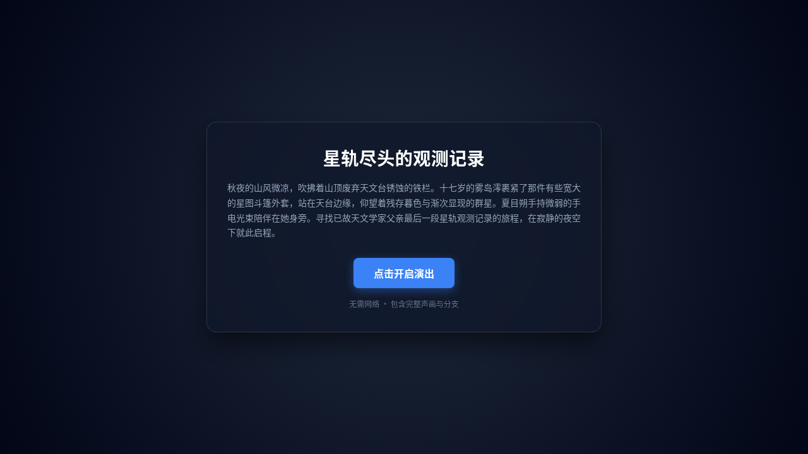
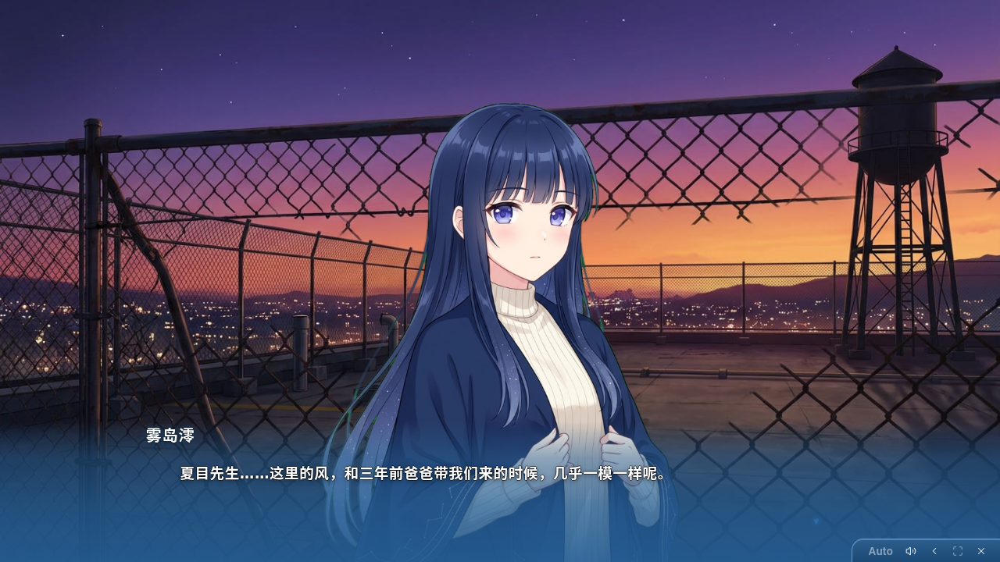
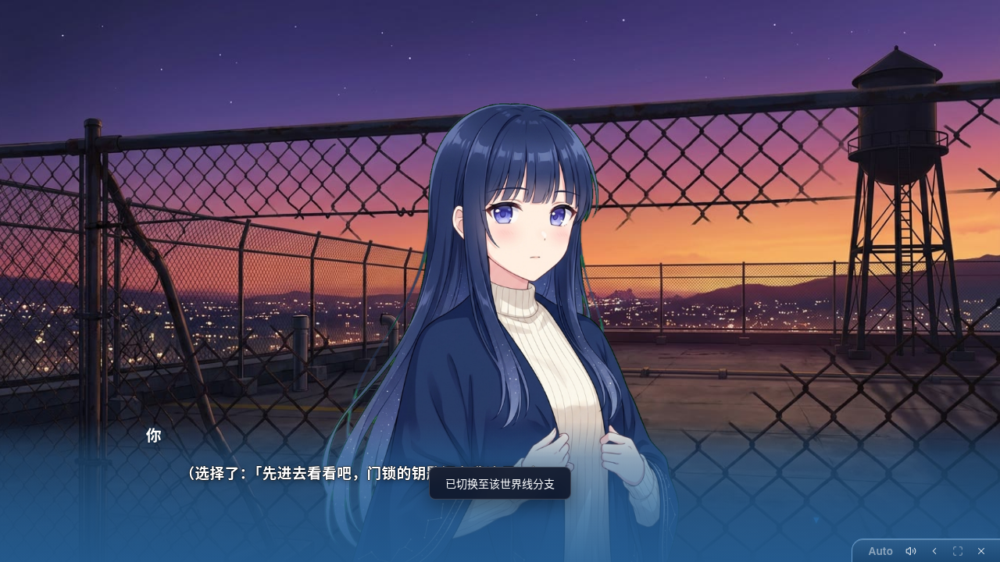

# 演后剧目导出单 HTML 与接续演出实现总结

日期：2026-10-14  
分支：`feat/play-export-replay`  
状态：已完成并通过端到端实测

---

## 1. 交付成果

1. **单 HTML 导出**：
   - 标题页与 HTTP API（`GET /api/plays/:id/export?format=html`）支持一键导出自包含的单文件 `.html`。
   - 文件内包含完整的剧目配置、角色设定、记忆、谱系日志、舞台素材（背景、立绘、CG、BGM、音效）以及实际生成的 TTS 配音。
2. **零 API 本地回放**：
   - 任何人收到该 `.html` 文件，双击在本地浏览器（Chrome/Edge/Firefox/Safari）中打开即可完整播放。
   - 页面内置轻量舞台播放器，自动从内嵌数据块解包资源并映射为内存 Blob URL。
   - 还原视觉小说舞台声画：背景转场、立绘表情差分、台词打字机节奏、BGM 循环与 TTS 语音播放。
   - 分支跳转：已演出的分支点击直接无缝跳转并继续播放；未探索选项弹出“该分支尚未生成，导入 Stage AI 即可继续开演”友好提示。
3. **导入继续演出**：
   - 剧目库「导入」支持直接选择或拖入 `.html` 文件。
   - 服务端自动检测并提取内嵌的剧目归档解压落盘；若本地已有同名剧目，自动重命名为 `<id>-continued` 并标注 `(续演)`，杜绝覆盖。
   - 导入后 `session.json` 与 `lineage.jsonl` 完好恢复，打开剧目点击「继续」或选择未探索选项，本地 Agent 自然接管上下文继续往下演。

---

## 2. 核心改动清单

- `apps/server/src/exportReplay.ts`：剧目文件与素材打包、`voiceMap.json` 映射生成、单 HTML 组装与 HTML Base64 提取解包。
- `apps/server/src/store.ts`：`PlayLibrary` 新增 `exportPlayedHtml`、`exportPlayedZip`；`importZip` 支持识别 HTML 格式与同名自动防覆盖重命名。
- `apps/server/src/http.ts`：`GET /api/plays/:id/export` 增加 `format=html` 分流。
- `apps/server/src/paths.ts`：增加 `standaloneAssetsDirOf` 寻址。
- `apps/web/src/standalone/`：基于 `@aivn/stage` 和 `@aivn/core` 构建的独立离线播放器。
- `scripts/build-standalone-replay.mjs`：打包生成 `standalone-player.js`（~316KB）与 `standalone-player.css`（~120KB）。
- `apps/web/src/views/TitleView.tsx`：底栏提供 `HTML`（演后离线单文件）与 `ZIP`（模板包）双导出入口。
- `apps/web/src/views/LibraryView.tsx`：导入文件支持 `.html,.htm`。

---

## 3. 实测截图证据

- **开屏界面**：
  
- **单 HTML 离线舞台回放（立绘、背景与台词）**：
  
- **分支选项与世界线切换**：
  
