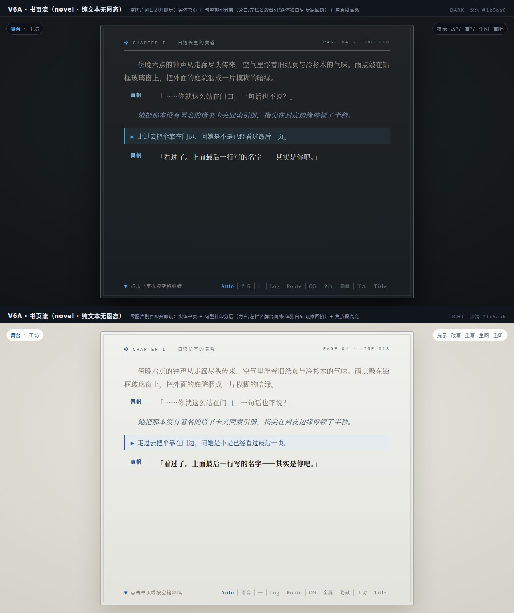
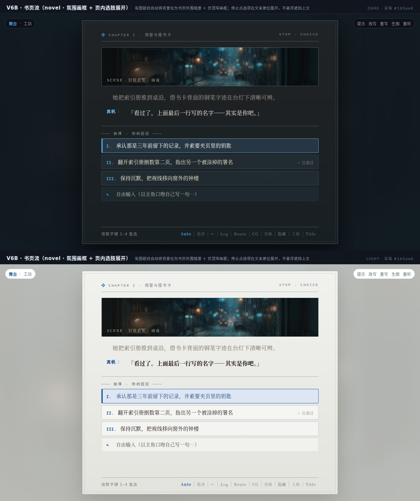
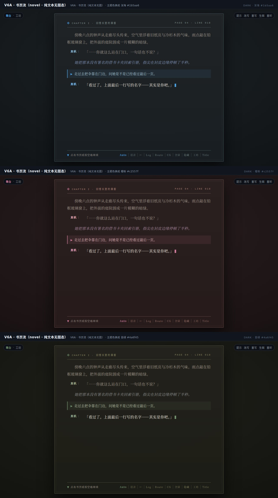
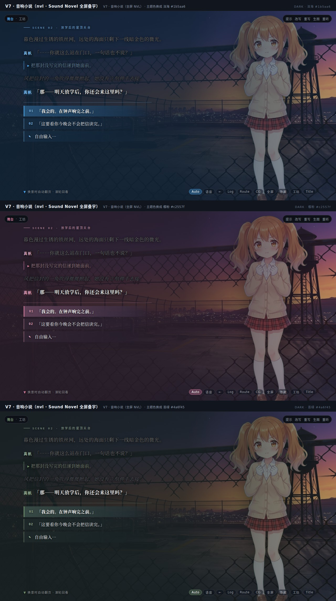
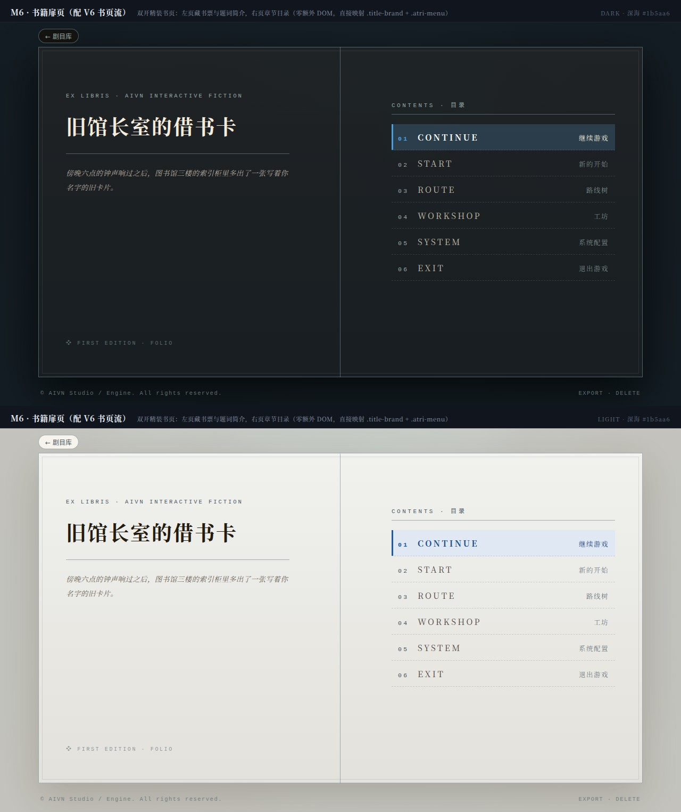
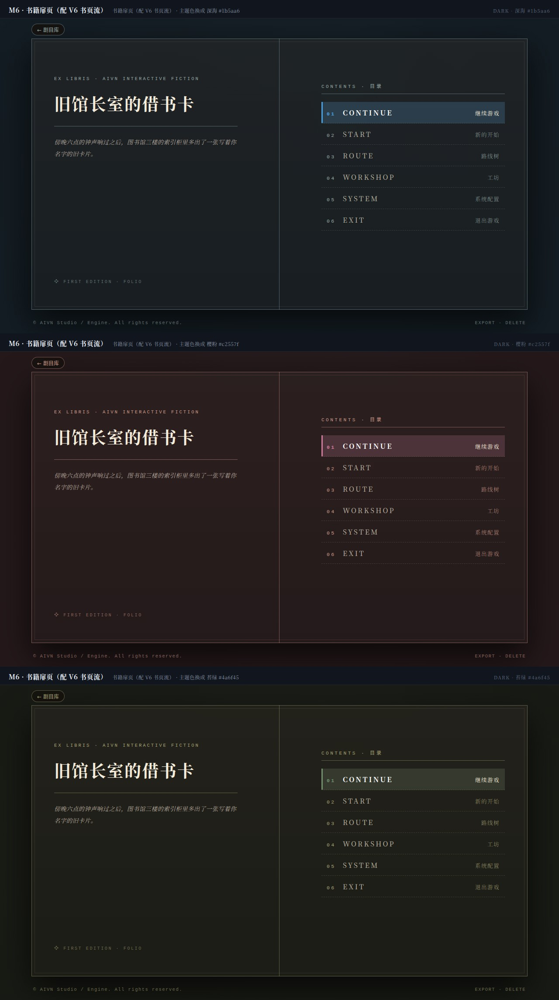
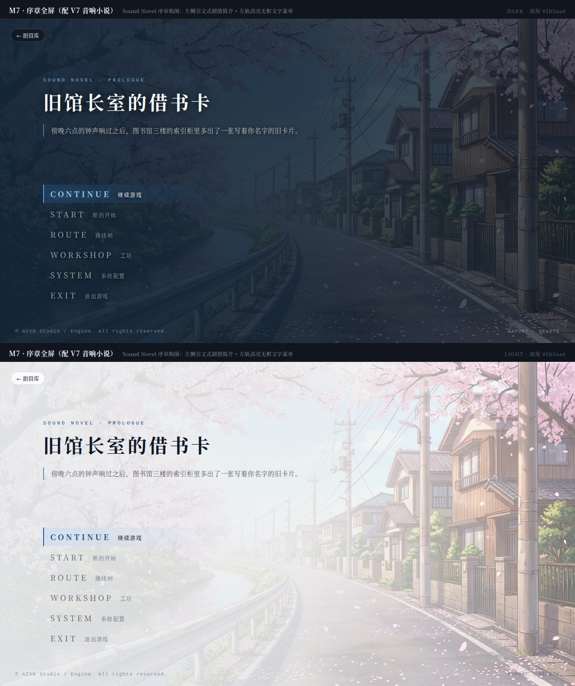
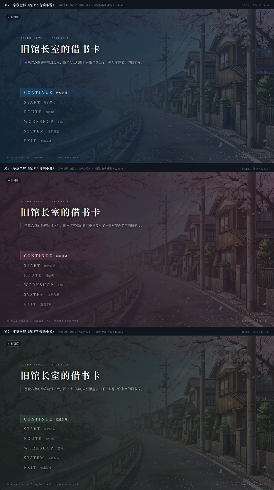

# 纯文本 / 文本为主的互动小说主题变体（`novel` / `nvl`）调研与设计方案

- 外部调研全文：[`261013-text-interactive-fiction-ui.research.md`](./261013-text-interactive-fiction-ui.research.md)
- 原型与重渲染：`docs/features/261013-text-novel-variant/showcase.html`、`title-showcase.html`、`node docs/features/261013-text-novel-variant/render.mjs`

---

## 一、核心结论：能否作为一种主题（`--play-style`）支持？

**能，且完全复用现有主题通道与播放状态机，无需改动服务端、DSL 或谱系数据结构。**

1. **配置与切换机制完全同构**：
   - 沿用 `plays/<id>/theme.css` 的 `--play-style: <id>`（及 `/* aivn-play-style: <id> */` 注释），在现有 6 档（`atri` / `card` / `cinema` / `hud` / `scroll` / `velvet`）之上新增「文本为主」档位，一个选项成套切换**开始菜单 + 舞台阅读面 + 停止点选肢**。
   - 材质底色（夜读纸 / 棉纸 / 渐变暗纱）与结构色（名牌左尺、焦点环、已选标记、页眉刊头）全部通过 `color-mix(in srgb, var(--accent) …)` 从剧目主题色派生，并支持 `html[data-ui-theme="dark|light"]` 双模式。
2. **与现有 6 档 ADV 主题的唯一结构差异（连续段落流 vs 单句框）**：
   - 现有 6 档是 **ADV 单句替换模式**：`.theater-dialog` 只渲染当前正在播放的一句（`playback.view`），`.choice-overlay` 悬浮在画面中央。
   - 互动小说 / 音响小说是 **连续段落累积模式（Page / Prose Flow）**：同屏保留此前已读段落（直接取 `playback.history` 中属于当前场景/当前页的条目，正序排列）+ 当前打字机推进句（`playback.view`），停止点选肢紧随文末展开。
   - `usePlayback`（`packages/stage/src/director.ts`）已经算好了 `playback.history`（播放头之前的 `TranscriptEntry[]`）、`playback.view`（当前句）、`playback.scrubbed`（回看态）和 `lines`（含 `<scene>` 换景节点）。`StageTheater` 只需在段落流渲染树中把「本页已读条目 + 当前行 + 页末选肢槽位」按序输出，即可在不碰任何状态机与协议的前提下原生支持。

---

## 二、两种「文本为主」变体设计

外部调研表明，「文本为主的互动小说」存在两条成熟但取向不同的经典谱系：
- **谱系 A · 书页流（`novel` · Literary Page）**：以 Inkle（《80 Days》《Sorcery!》）、Twine Chapbook、Reverie 小说模式为代表——**以实体书页为中心**，最适合纯文本无图剧目或插图点缀的文学向剧目。
- **谱系 B · 音响小说（`nvl` · Sound Novel）**：以 Chunsoft（《弟切草》《镰鼬之夜》《428》）、Type-Moon（《月姬》《魔法使之夜》）为代表——**全屏画面与立绘在场、整屏半透明纱叠字**，适合有背景/立绘/配乐但以长段叙述和心理描写为主的剧目。

### 1. V6 · 书页流（`novel` · 互动小说书页）

#### V6A · 纯文本无图态（上下深浅对照）

#### V6B · 带氛围背景 + 页内选肢展开态（上下深浅对照）

#### V6 · 三档主题色回声（深海 / 樱粉 / 苔绿）

- **版面与行宽**：居中纵向书页（宽 `min(780px, 86%)`，内边距 `34px 58px`，每行约 32–36 个汉字，落在 JLReq 与中文长文阅读最佳行宽区间），外框双线细描边，顶部配 Running Header（当前场景名 / 章节名与序号）。
- **无图与有图自适应**：
  - **无图态**（剧目未配背景/立绘，或 `craft.assets` 关闭出图）：外围画布为深色夜读炭黑 / 浅色暖棉纸，书页本身即完整舞台，不露「缺图空场」痕迹。
  - **有图态**（剧目有 `<scene bg>` 或 `<cg>`）：外围画布将背景图做 `blur(22px)` 氛围化衬底，书页顶部内嵌窄幅场景画框（Scene Plate，高 `118px`）或行内 CG 插图，立绘默认不在书页外遮挡视线。
- **四类句型排印语法（零气泡）**：
  - **旁白（`narrate`）**：衬线正体，首行缩进 `2em`，行高 `1.92`。
  - **台词（`say`）**：左栏悬挂小字距无衬线角色名牌（右对齐 + `1px` 主题色竖线分隔），正文左对齐不缩进，多行台词严格对齐左轨。
  - **内心独白（`thought`）**：整段左缩进 `2em` + 斜体 + 掺入主题色的柔和次级墨色。
  - **玩家输入回执（`input`）**：借鉴 Reverie 小说模式与 Parser IF 传统——左侧 `2px` 主题色边线 + 淡底 + `▸` 引导符，融于散文流中。
- **焦点引导与推进**：已读段落墨色收敛至 `66%` 不透明度，当前正在打字或刚落定的一句（`.is-current`）保持 `100%` 对比度与字重提升，句尾配主题色闪烁光标。
- **文末选肢**：停止点选项不再悬浮在画面正中遮挡前文，而是紧随书页当前段落下方（带 `─── 抉择 ───` 分隔线），罗马数字或序号领起，左对齐书签条样式。

---

### 2. V7 · 音响小说（`nvl` · Sound Novel 全屏叠字）

#### V7 · 全屏叠字 + 焦点段高亮 + 页末选肢（上下深浅对照）

#### V7 · 三档主题色回声（深海 / 樱粉 / 苔绿）

- **画面与遮罩**：背景图与立绘全屏正常演出；整屏覆盖一层**左浓右淡**的非对称渐变纱（左侧文字区深色下 `90% -> 82%` 掺主题色暗海蓝、浅色下 `94% -> 88%` 掺主题色和纸白，保证 WCAG >7:1 对比度；右侧渐淡至 `25%`，把右侧立绘完整让出来）。
- **《魔法使之夜》式焦点层**：同场已读句以 `opacity: 0.52` 留在上方，当前句 `100%` 纯白（浅色下深墨）+ 四向微描边高亮。
- **换页规则**：遇到 `<scene>` 换景或新一轮分界时自动清页（等价于 Ren'Py `nvl clear`），页内超出可视高度时平滑自动滚到底部，手动上滚即进入回看（`scrub`）。

---

### 3. 配套开始菜单（M6 书籍扉页 & M7 序章全屏）

严格复用 `TitleView.tsx` 现有 DOM（`.title-screen > .title-art + .title-veil + .title-top + .title-brand + nav.atri-menu + footer.title-footer`），**零 JSX 改动**：

#### M6 · 书籍扉页（配 `novel` 书页流）

- `.title-screen::before` 绘出双开精装书页与中缝书脊线；
- 左页（`.title-brand`）：顶部 `::before` 印藏书票刊头 `EX LIBRIS · AIVN INTERACTIVE FICTION`，中段大号衬线剧名，下方分隔线配斜体题词简介（Epigraph），底部 `::after` 印版本落款；
- 右页（`.atri-menu`）：顶部 `::before` 印 `CONTENTS · 目录`，6 个菜单项按 `counter(ch-no, decimal-leading-zero)` 自动编号，英文主标在左、中文副标居右，虚线底边分隔。

#### M7 · 序章全屏（配 `nvl` 音响小说）

- 全屏背景压左浓右淡渐变纱；
- 左上 `.title-brand`：等宽小字距 `SOUND NOVEL · PROLOGUE` 导标 + 衬线大字剧名 + 左竖线引文式简介；
- 左下 `.atri-menu`：无框左对齐文字菜单，悬停/聚焦项左侧点亮主题色竖尺与横向渐隐光带。

---

## 三、架构与实现方案

### 1. 连续段落流（Page Flow）的数据投影纯函数

在 `packages/stage/src/playbackState.ts` 新增纯函数 `buildPageEntries`：
- **输入**：`transcript: readonly TranscriptEntry[]`、`current: ScriptLine | null`、`view: TranscriptEntry | null`、`viewLength: number`、`scrubbed: boolean`、`lines: readonly ScriptLine[]`。
- **分页边界（Page Break）**：
  - 取当前显示行（`view`）所在的场景页：以 `lines` 中最近的 `<scene>` 行或 `<title>` 行作为自动换页边界（同一场戏内的台词、旁白、独白、玩家输入连续累积在同一页上；换景即翻开新的一页，避免无限长卷把十几个场景混在一页里）。
  - 书页流（`novel`）可通过内部滚动条回看同场前文；滚轮或方向键照常驱动 `playback.scrub` 逐句回溯并高亮对应历史句（`.is-current` 跟随 `view.key` 移动）。
- **输出**：`PageLine[]`（每项含 `key`、`kind`、`type`、`actorId`、`nameOverride`、`text`（当前打字行截取到 `viewLength`，已读行取全文）、`isCurrent: boolean`）。

### 2. `StageTheater` 组件适配（最小无损扩展）

在 `packages/stage/src/StageTheater.tsx`：
- `.theater-dialog` 内保留原有的单句 `.dialog-name` + `.dialog-text`（供 `atri` / `card` / `cinema` / `hud` / `scroll` / `velvet` 6 档 ADV 风格使用，CSS 与 DOM 行为零变化）。
- 新增 `.dialog-page` 列表容器（默认在 ADV 风格下 `display: none`，仅在 `html[data-dialog-style="novel"]` 或 `html[data-dialog-style="nvl"]` 下 `display: flex`，同时将单句 `.dialog-name` / `.dialog-text` 隐藏）：
  - 顶部页眉 `.dialog-page-head`（显示当前场景名或剧名 + 行序号）；
  - 当 `novel` 模式下存在当前背景图（`bgUrl`）或行内 CG（`cgUrl`）时，渲染可选的 `.dialog-scene-plate` 窄画框；
  - `.dialog-page-flow` 渲染 `pageEntries` 列表（每条带 `.page-entry.${type}` 与 `.is-current`，当前未打完的行末尾挂 `.dialog-caret`）；
  - `overlay`（`StopPanel`）：仍在原位置渲染，在 `novel` / `nvl` 风格下通过 CSS 将 `.choice-overlay` 定位/排布到书页下半段，与正文流对齐。

### 3. 主题与配置面联动

| 文件 | 改动内容 |
| --- | --- |
| `apps/web/src/ui/playTheme.ts` | `PlayStyleId` 新增 `"novel"`（书页流 · 互动小说）与 `"nvl"`（音响小说 · 全屏叠字）；`PLAY_STYLES` 增加对应中文标签 |
| `packages/stage/src/ playbackState.ts` | 新增 `buildPageEntries()` 纯函数及单测（覆盖换景自动分页、打字机截断、回看游标移动、玩家输入回执合并） |
| `packages/stage/src/StageTheater.tsx` | 渲染 `.dialog-page` 连续流容器与自动滚底 `useEffect`（跟随 `view.key` 与 `shownLength`） |
| `packages/stage/src/stage.css` | 文件末尾新增 `html[data-dialog-style="novel"]` 与 `html[data-dialog-style="nvl"]`（含 `light` 浅色分支与 `≤720px` 窄屏响应式断点） |
| `apps/web/src/app.css` | 文件末尾新增 `html[data-menu-style="novel"]`（M6 书籍扉页）与 `html[data-menu-style="nvl"]`（M7 序章全屏）及 `≤760px` 窄屏规则 |
| `apps/server/skills/galgame-ui-style/SKILL.md` | 更新 `--play-style` 可选值说明，补充 `novel` 与 `nvl` 的设计语言与适用题材 |
| `packages/core/src/play/config.ts` & `apps/web/src/workshop/PlayPane.tsx` | （可选增强）`CRAFT_BACKGROUND_SOURCES` 增加 `"off"`（「不用背景图」），让纯文本互动小说剧目在工坊「剧目 → 写作参数」里可以一键把背景、CG、立绘全部设为「不用」，彻底不触发任何图片导入或生成 |

### 4. 与创作参数（`craft`）的关系

- **显示方式（`theme.css` 的 `--play-style`）与素材策略（`play.json` 的 `craft.assets`）正交解耦**：
  - 任何现有带图剧目切到 `novel` 或 `nvl`，无需改剧本或删素材，立刻以「书页流」或「音响小说」方式演出；
  - 若作者要创作一部**纯文本互动小说**（零生图开销、纯靠文字与配乐/语音演出），只需在工坊把界面风格设为 `novel`，并将写作参数的背景/CG/立绘设为关闭。目前 `craft.assets.cg` 与 `craft.assets.sprite` 已有 `"off"`，而 `craft.assets.background` 只有 `"library-first" | "library" | "generate"`——顺手为 `background` 补上 `"off"` 选项，纯文本剧目的配置闭环就彻底完整了。

---

## 四、待确认决策点

1. **档位取舍**：是将 **`novel`（书页流）** 与 **`nvl`（音响小说）** 两档都加入「界面风格」下拉框（共 8 档），还是只合入其中一档？
2. **有图剧目在 `novel`（书页流）下的画面展示**：当剧目有背景图/CG 时，是否采用原型 V6B 的「外围模糊暗景 + 页顶窄幅场景画框（Scene Plate，无图时自动隐藏）」设计？
3. **`craft.assets.background` 是否补齐 `"off"`（不用背景图）**：以便纯文本互动小说剧目可以在写作参数里把背景图也彻底关掉？
