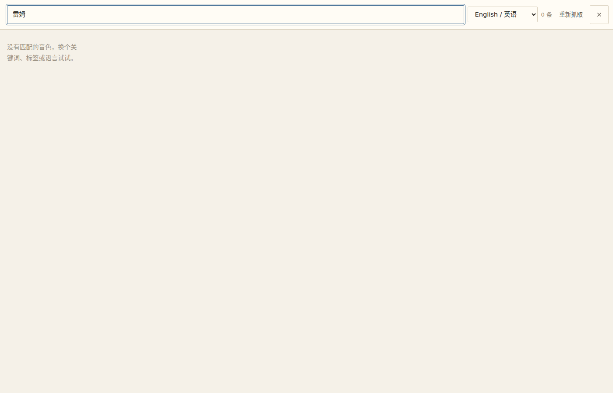
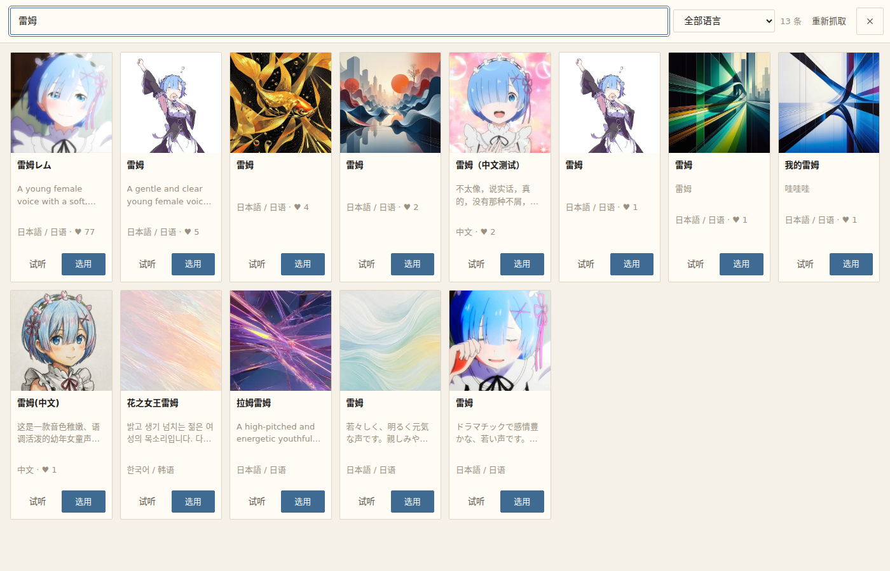
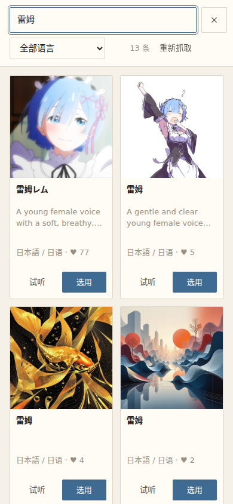

# 音色库搜索修复 验证

改动：搜索框不再被「默认语言」截断（关键词 = 全库标题搜索）；面板的标签区域按用户裁决撤掉
（标签筛选仍在 API 与 `list_voices` 上）。诊断见 `261010-voice-search.troubleshoot.md`。

线上实例（改动后）：**https://stage.johnnren.qzz.io**（局域网 `http://<本机IP>:8787`）。

## 用户验收（请真人过一遍，两条）

1. 任一剧目 → 工坊 → **角色**页 → 角色卡的「音色」→ 面板顶部搜索框输 **雷姆**
   → 计数应是 **13 条**（不再是 0 条 / 2 条），语言下拉此时显示「**全部语言**」。
2. 标签区域已撤掉（面板只剩 搜索 + 语言 + 卡片网格）；显式挑 **日本語** 再搜「雷姆」
   → 仍是语言与关键词 AND 的那 10 条，清空关键词回到日语的浏览窗口。

## 改动前后（同一台浏览器，系统语言 = en）

改前：搜索走 `?language=en&q=雷姆` → **0 条**，且界面上没有任何标签。

改后：搜索走 `?q=雷姆` → **13 条**；标签区域已撤掉（桌面版）。

改后：手机宽度（390×844）——顶部只剩两行工具栏，网格立刻开始。

## 回归面

- 无关键词时仍按系统语言预选窗口（中文系统看中文音色）；切语言照旧按需拉 Fish 窗口。
- 显式挑过语言后再搜索 = 语言与关键词 AND；清空关键词回到该语言窗口。
- 试听、选用、目录外 voiceId 按 id 解析、`list_voices` 工具：未动。
