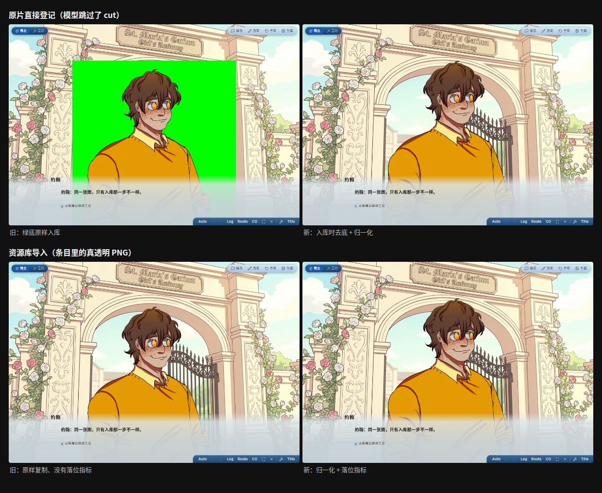
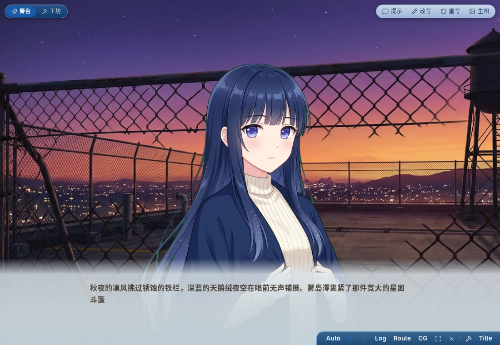

# 立绘入库收口（机制修复）——实施摘要

计划见 [`261012-sprite-ingest.plan.md`](261012-sprite-ingest.plan.md)。
前情（只修了一条分支的那次）：`docs/issues/261012-sprite-cut-headroom/`。

## 做了什么

**一份实现**：`@aivn/agent` 的 `prepareSprite(bytes, {framing})` —— 按输入分两支，
产出的画布与指标口径完全一致：

**判据是先看透明、再看底色**（透明像素占比 ≥ 0.5% 就当已抠好）：

| 输入 | 走哪支 | 结果 |
| --- | --- | --- |
| 已经抠好的透明 PNG（资源库条目、用户上传、切过的成品，哪怕透明像素里还残留原底色 RGB） | 只重排画布 | 该 framing 的画布、顶留白 5%、人物 95%（幂等：再跑一遍两格指标一格不差） |
| 整张不透明的纯色键底原片（生图直出） | `cutout()` 去底 + 归一化 | 同上 |
| 既不是色键底、也没有成片透明区域 | —— | 当场报错，说清两种合法输入 |

归一化的算法只有一份：`cutout` 尾部的落画布那一段抽成了 `placeOnCanvas()`，两条支路共用。

**一个编排点**：服务端 `spriteIngest.ingestSprite()` = 归一化 → 落盘（含清同 stem 旧扩展名）→
`declareSprite` 落两格指标。自称「立绘入库的唯一写口」。

**六条写口全部改成走它**：

| 写口 | 改法 |
| --- | --- |
| `commit`（草稿 → 入库） | 内联 `cutout` 换成 `PlayAssets.normalizeSprite`（= `prepareSprite` + `STAGE_CUTOUT_*` 调参） |
| `register`（`import_asset`） | 同上；登记前先归一化，指标随 `spec` 进 `declareSprite` |
| `cut`（路径 / 素材引用两条分支） | 同上；画幅仍按 草稿取景 → 素材表声明 → 缺省 full |
| `recut`（原地重抠） | 同上（留底原片是色键底，走的就是去底那支） |
| 资源库导入 `importFromLibrary` | 不再 `copyFile` 直写：读字节 → `ingestSprite` → 指标并进素材表 |
| 素材页上传 `POST /assets` | 改走 `playhouse.putAsset`：立绘过同一条路，其余类目照旧 |

落位形状也收在一处：`assets/sprites/**` 只认 `<主体>/<差分>.<扩展名>`（`assertSpriteLanding`，
`cut` 的 `output` 与素材页上传的回落写都在写盘前过它），**这个目录只有 `ingestSprite` 一个写口**。

顺带清掉三处重复：`AssetIo` 的构造（`assetFiles.assetIoOf`）、素材表的读改写
（`assetFiles` 的 `parseManifest`/`readManifest`/`writeManifest`，同时修掉旧格式字符串值被 spread 成对象的老问题）、
资源库导入里那份 `readManifest`。

## 实拍（同一张图、同一套舞台，只有写口新旧之分）

- 上排「原片直接登记」（模型跳过 `cut`）：旧 = 一张绿底不透明 PNG 直接长在舞台上；新 = 去底 + 归一化。
- 下排「资源库导入」：旧 = 原样复制（自带留白、素材表没有指标，舞台按旧行为把图片盒放大 132%）；
  新 = 该 framing 的画布 + 指标，头顶与大小回到与出图那条路同一种摆位。

造图与截图用的 mock 周目与脚本已删（跑批产物不进 git）。

**回归**：上一轮那个剧目仍然对得上——工作树服务端（改后的代码）跑 `mio-observatory`，
`neutral` 实测 `--sprite-top: 13.26% / --sprite-height: 94.74%`（与上一轮修完的数一致）。

## 量出来的数

- 包内单测：色键原片 → 1440×1920（half）/ `figureTop 96` / `figureHeight 1824`；已抠好的 PNG →
  重排到画布且**幂等**；不透明无键底 → 报错。
- 服务端：资源库导入后 `assets/sprites/<id>/neutral.png` 是 1920 高、素材表带两格指标；
  `register` 直接登记未抠底的草稿 → 透明 PNG + 指标（新用例）。

## 检视

检视报告见 [`261012-sprite-ingest.review.md`](261012-sprite-ingest.review.md)：首轮**不准入**（阻塞 B1 +
两条建议 S1/S2），按建议改完后复检**准入**：

- B1：`cut(target, output)` 直写 `assets/sprites/`，绕过落位与指标声明 → 两条分支都改走统一入库，
  非立绘的回落加 `assertSpriteLanding` 守卫（非标准形状直接拒绝，这是该目录的第二个写口）。
- S1：透明 PNG 的透明像素残留原底色 RGB → 判据改成先看透明、再看底色。
- S2：任一 `alpha < 250` 就认「已抠好」→ 改成透明像素占比 ≥ 0.5%。
- 留作已记录边界的：0.5% 这个固定阈值（两个方向的误判都不会静默——一边是背景留在台上看得见，
  另一边是明确报错并给出底色极差与透明占比）。

## 未做

- **不为存量素材做迁移**：已经在 `assets/sprites/` 里的图保持原样（缺指标的仍退回旧行为）。
- **没改 `dsh-aivn`**：共享包只多了 `prepareSprite` 这个原语，`adoptDraft`/`registerAsset` 的行为没动，
  所以 DSH 那条线这次一个字节的行为都没变（它自己的写口等那边按同一套收口）。
- 素材页上传的立绘会落成 `.png`（归一化的产物恒为 PNG），同 stem 的旧扩展名被落位那一步清掉。
