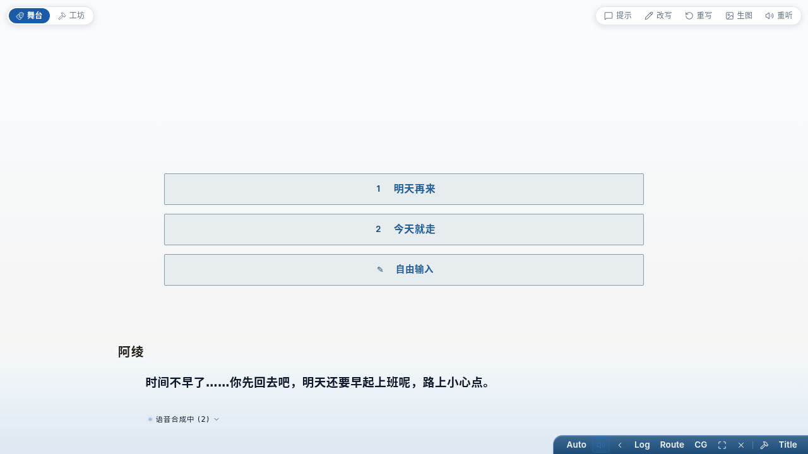

# 重听按需补生成 — 修复小结（261012）

## 结论

用户期望成立并已落地：**没有音频的行，重听键照样在，点一下就按这一行当时的台词补生成并播放**。

三处改动合起来支撑这件事：

- **协议**：新增 `voice_request {seq}`（客户端点名补生成）、`audio_failed {seq, phrase}`（合成失败明说一声，
  界面不必等 45s 兜底才熄灯）；hello 的 `cast` 每项加 `voice`（这个角色配得出声吗）。
- **服务端**：`VoicePipeline.synthesizeLine` 按同一套分句规则把整行**一次性排上**再合成——
  客户端据此知道这一行一共几句，等齐了才播（不会又切成「只配前半句」）；生成过的短语命中内容寻址缓存，
  秒回且不重复烧配额。`orchestrator.requestVoice(seq)` 从事件流取回**当时那一行**的说话人与台词。
- **客户端**：`VoiceDirector.requestReplay(seq)`——台账里有就直接重播；没有就请服务端补生成、等短语收束再起播。
  界面按 hello 带来的 `voiceCast` 决定摆不摆这个键（没给这张表的宿主行为与改动前一致）。

## 一致性（改写过的行不能播旧声音）

`requestVoice` 取的是**谱系里的当前文本**（`LineageTree.textOf`，与 `materialize` 同一处规则），
不是事件流里那份原文；并且原地改写会给这一行的台词**抬一代**（`VoicePipeline.invalidateLine`）：
排队里的旧活儿直接扔，在飞的那几句结果回来时认代次不再发出（`fresh(job)`），
观众不在时攒下的帧也带代次、补推前再筛一遍。客户端同步作废那一行的台账与正在播的声音
（`forgetLine`），并在用户重新点名之前一概不收它的帧（`voided`）。

## 按钮不会被点死

补生成的等待有 20s 上界，且「换行 / 关语音 / 新轮 / 卸载」都会放下等待记号：
断线丢掉请求、服务端不受理、或中途关了语音再打开，同一行过一会儿都还能再点一次
（这一条正是用户报的那个症状的反面：键必须一直有效）。连点只求一次（幂等记号 + 等待代号）。

## 验证

- 单元：`@aivn/core` 272 例、`@aivn/stage` 72 例（`voiceReplay.test.ts` 十一条）、
  `@aivn/server test/voice.test.ts` 17 例全绿；`pnpm typecheck` 全绿。
- 真机 E2E（假模型网关 + 真 Fish）：语音关着演完一轮 → `ready 0 / 缓存 0` → `voice_request` →
  `pending=[0,1] ready=[0,1] 缓存文件=2`（帧沿用原 seq、整行短语一次性报齐）。
- 浏览器 E2E（headless Chromium 打真服务端）：演完一轮 → **刷新**（台账清零）→
  工具栏出现「这一句还没有语音，点一下生成」→ 点击 → 发出 `voice_request {seq:35}` →
  服务端回 `audio_pending 35/0 35/1` 再回 ready → 客户端拉取该行音频并起播 → 键变「重听这句」。

## 检视

`261012-voice-replay-regenerate.review.md`：六轮，最后**准入**、无阻塞项。前五轮的四条阻塞项都已闭环：
①改写过的行会用旧文本合成；②改写与在飞旧请求并发时旧帧写回台账；③deferred 帧绕过代次校验；
④幂等记号把重试入口焊死 + 换行时旧计时器提前解开新行等待。

## 遗留

- 台账**部分有**的行（前半句在、后半句不在）走「直接重播已有」的快路，不补后半句。
  要一并治得让客户端知道「这一行一共几句」——把 `audio_pending` 的语义从「正在合成」
  扩成「这一行有几句」，属协议层的另一笔。
- 部分短语失败时，按剩余短语播放；没有失败提示。
- **角色换音色不追溯旧录音**：过去生成好的行按「录音」保留，重听照放旧声音。声音是内容寻址
  （`sha1(voiceId + 文本)`），要连带作废得先有产品口径，本次不把它隐式塞进语音开关或台账失效。
- `dsh-aivn` 不传 `voiceCast`，按需生成的键在那条线上不出现（行为与改动前一致）；
  `packages/core` + `packages/stage` 都动过，按跨线验证矩阵要单独走 DSH 侧构建与舞台验证。
