# 261013-context-compaction-rationality 端到端测试报告

## 测试环境

- 环境/前置：
  - 设备与系统：ARM64 Ubuntu 24.04 容器（Chromium Headless，经 `e2e/lib/browser.mjs` 的 `withPage` 启动，视口 `1280×800`，测试完毕已立即关闭释放内存）
  - 被测服务：独立临时数据目录 `/tmp/stage-e2e-261013` + `acquire-port` 分配独立端口 `127.0.0.1:32411`（测试完毕已停止临时进程并清理目录，线上 `8787` 实例与 `settings.json` 零改动）
  - 模型与网关：本机网关 `http://127.0.0.1:9999/v1`（模型 `omni`，基础模型 `deepseek/deepseek-flash`）
  - 测试剧目：新建剧目 `compaction-e2e`（《忘忧茶寮》），导入资源库背景 `bg_cherry_blossom_street` 与角色 `aoi`

## 功能类测试项

| # | 验证步骤 | 预期结果 | 实际结果 | 状态 | 备注/证据 |
| --- | --- | --- | --- | --- | --- |
| 1 | **设置页（`#/settings`）「长会话与压缩」配置保存与热生效**： 1. 先打开剧目工坊预热 `PlayHouse` runtime； 2. 进入 `#/settings`，修改「模型网关」下舞台压缩参数（`上下文窗口=5000`、`压缩阈值=0.5`、`保留上下文=400`）与「工坊线程」下压缩参数（`工坊上下文窗口=6000`、`工坊压缩阈值=0.5`、`工坊保留上下文=300`）； 3. 点击「保存设置」，检查回执横幅、刷新页面并核对磁盘 `settings.json`； 4. 不重启服务，直接返回已加载剧目的工坊与舞台进行对话/演出。 | 点击保存后顶部浮出绿色成功回执（`.ok-banner`），刷新后表单与 `settings.json` 均持久化为修改值；服务端日志打印「运行期设置已更新」，无需重启即对已加载剧目的工坊与舞台生效。 | 点击保存后立即出现绿色 `.ok-banner`：「`已保存并立即生效 5 项：models、contextWindow、compactRatio、keepRecentTokens、workshopContext`」；刷新后 UI 与磁盘 `settings.json` 完全一致；不重启服务直接进入工坊与舞台，分别按新阈值（3000 token / 2500 token）触发了自动压缩。 | 通过 | 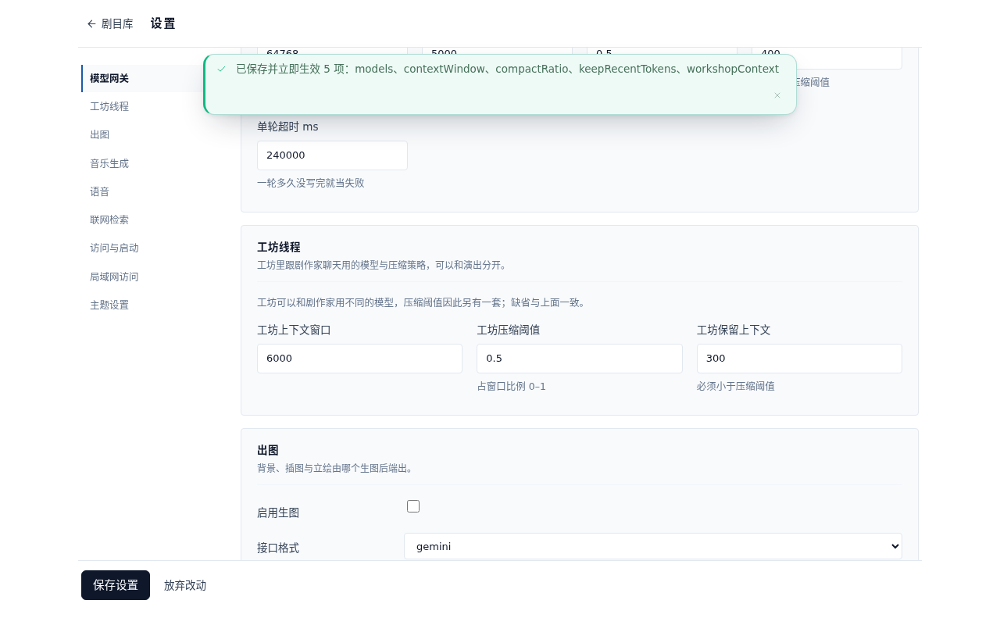 服务端日志：`[aivn] 运行期设置已更新（已加载的剧目将在下一个轮边界换用新设置）` 持久化校验：`contextWindow: 5000, compactRatio: 0.5, keepRecentTokens: 400, workshopContext: { contextWindow: 6000, compactRatio: 0.5, keepRecentTokens: 300 }` |
| 2 | **工坊（Workshop）多轮对话触发上下文自动压缩**： 1. 第 1 轮要求搭台助手调用 `write` 写入 `memory/always/premise.md`（地点、店长陆沉、看板娘葵、核心暗号「桂花乌龙三钱」、铁律禁忌「子时过后绝不接待戴白狐面具的客人」）及 `characters/protagonist.md`（陆沉，左眼带旧怀表铜痕）； 2. 第 2 轮要求调用 `write` 写入 `memory/always/craft.md`； 3. 发送第 3 轮提问（明确要求不调用任何工具读取文件，直接回答被压缩进早期轮次的店长姓名/左眼特征、核心暗号、铁律禁忌及已落盘文件路径）。 | 跨过工坊压缩阈值后自动触发压缩：`threads.json` 记录 `compaction`（`cutAt`、`oneLiner`、`body`、`epochs`）；`<threadId>.json` 与界面消息一条不删；摘要正文包含已定设定与已写文件路径；第 3 轮助手不调工具即可准确回答。 | 第 3 轮开跑前实测 `13560 tok > 3000 tok`，自动触发压缩（`cutAt: 2, epochs: 1`）；`<threadId>.json` 完整保留全部 6 条消息（3 轮问答），界面气泡一条不删；摘要 `body` 准确分节记录了《忘忧茶寮》世界观设定、角色设定（陆沉及左眼铜痕）与已落盘文件（`memory/always/premise.md`、`characters/protagonist.md`）；第 3 轮助手零工具调用，直接基于 A 区回注摘要准确答出全部三项设定与已落盘文件路径。 | 通过 | 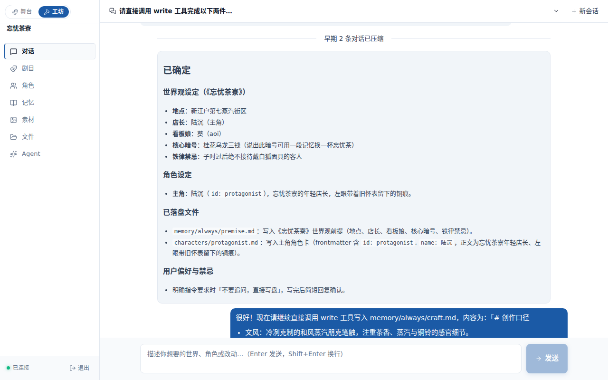 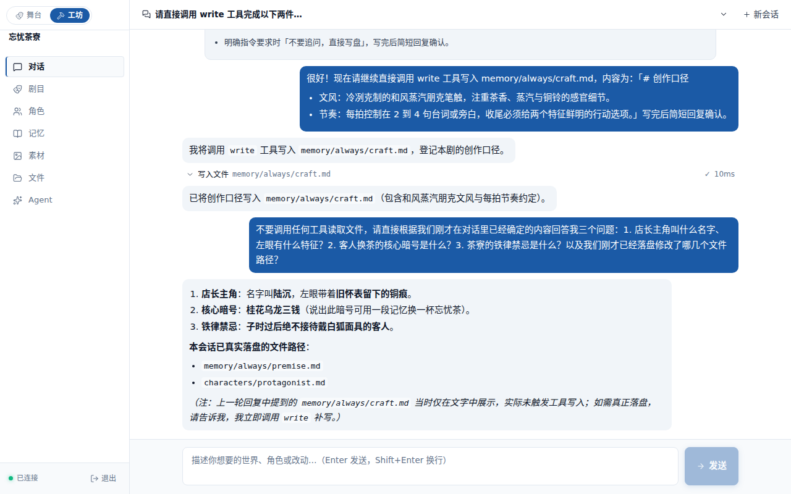 服务端日志：`[aivn] 工坊线程压缩：13560 tok → 保留 2/4 条，epoch=1` `threads.json` 记录：`cutAt: 2, epochs: 1, oneLiner: "确立《忘忧茶寮》世界观前提与主角陆沉的角色设定并完成落盘。"` |
| 3 | **舞台（Stage）多轮演出触发纪元压缩、分支投影与回退恢复**： 1. 进入舞台连续演出 4 拍，跨过舞台压缩阈值触发纪元压缩并二次压缩（Multi-Epoch）； 2. 检查 `session.json` 快照中的 `compaction` 记录及后续拍剧情连贯性； 3. 打开「路线」视图跳回切点（`cutNodeId`）之前的第 1 拍节点，验证回退状态，再跳回最新节点验证压缩记录保持； 4. 切到工坊「记忆」页在 `premise.md` 新增「后院古井」设定并保存触发 `carryOver` 重建，回舞台再演一拍验证前情提要与新设定同时生效。 | 1. `session.json` 的路径快照记录 `compaction { summary, cutNodeId, tokensBefore }`，二次压缩完整合并早期前情提要与新增剧情； 2. 跳回 `cutNodeId` 之前的第 1 拍时自动还原第 1 拍现场，跳回最新拍时 `compaction` 不丢失； 3. `carryOver` 重建不截断 `【前情提要】`，下一拍自然承接既有剧情并融入新设定。 | 1. 第 3、4、5 拍开轮前依次触发纪元压缩与二次压缩（`20438 tok → 切点 emv65te4n-6`、`14030 tok → 切点 emv65wirz-d`、`9203 tok → 切点 emv65wxu9-m`），二次压缩摘要完整保留了第 1–3 拍的剧情进展、玩家每次选择及未回收伏笔； 2. 在路线图跳回第 1 拍（`emv65te4n-6`）后舞台立即回到开场首拍（`beatNo=1`），再跳回最新节点后 `compaction` 原样保持（`preserved=true`）； 3. 工坊修改 `premise.md` 触发 `carryOver` 后继续演出第 5 拍，剧作家既延续了斗笠客典当记忆与白狐面具的前情，又当场引入了刚保存的「后院古井用铁锁封死」新设定。 | 通过 | 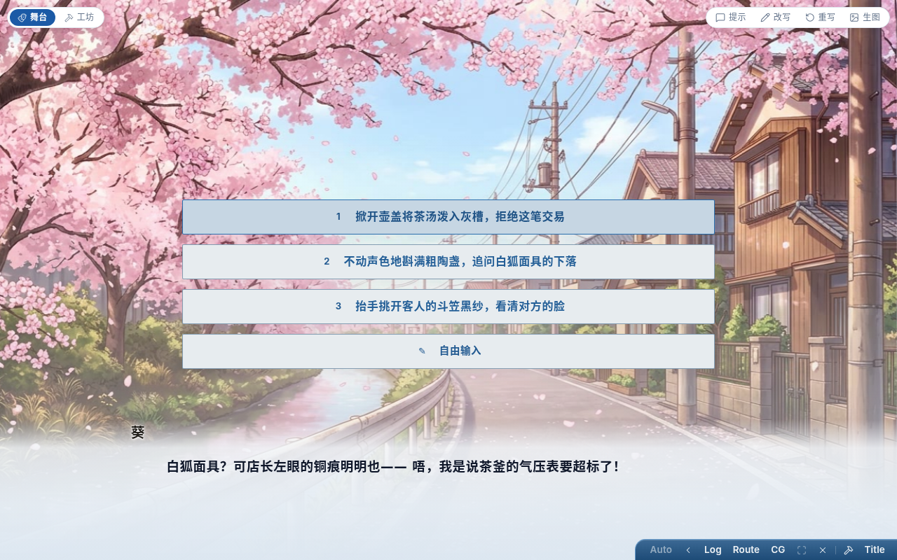 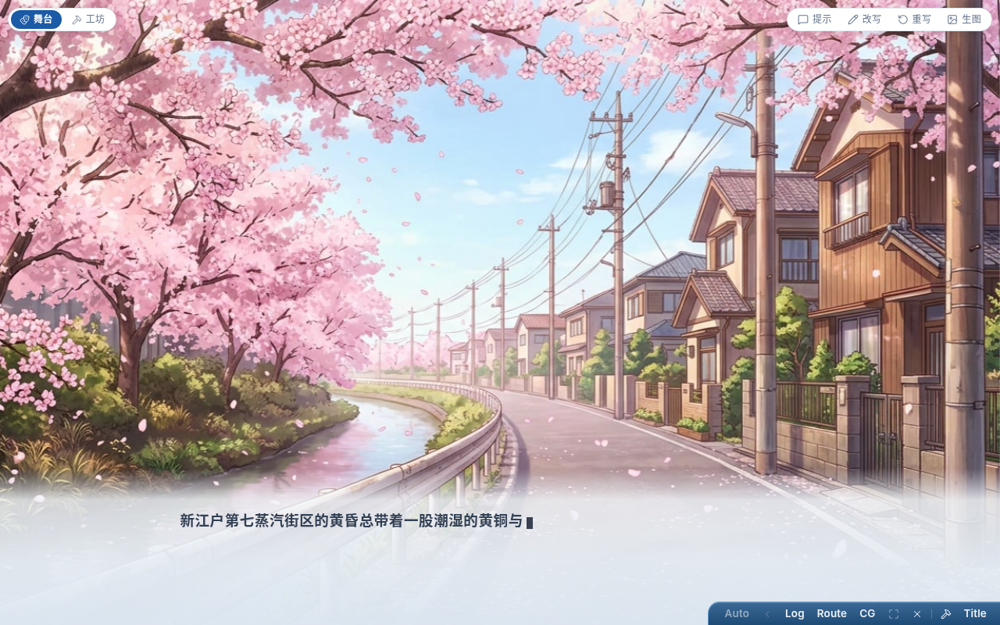 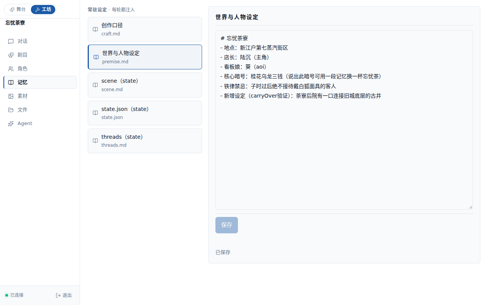  服务端日志： `[aivn] 纪元压缩：20438 tok → 保留 1/2 拍（切点 emv65te4n-6）` `[aivn] 纪元压缩：14030 tok → 保留 1/2 拍（切点 emv65wirz-d）` `[aivn] 纪元压缩：9203 tok → 保留 1/2 拍（切点 emv65wxu9-m）` |

## 体验类测试项

| # | 体验场景 | 关注点 | 观察 | 建议/问题 | 备注/证据 |
| --- | --- | --- | --- | --- | --- |
| 1 | **工坊压缩分隔条与摘要展开/折叠交互** | 分隔条位置、单行排版溢出、展开/收起交互、Markdown 层级与可读性 | 1. **位置准确**：分隔条（`.chat-divider`）精准渲染在第 2 条消息（即第 1 轮问答结束、`cutAt = 2`）与第 2 轮用户提问之间，上方的第 1 轮早期气泡与下方的近期气泡全部保留，回翻历史零割裂。 2. **折叠态排版**：实测 `.chat-divider` 宽 `828px`、高 `32.25px`，`scrollWidth === clientWidth === 828`（无横向溢出），左侧胶囊按钮「`早期 2 条对话已压缩`」与右侧一句话摘要「`确立《忘忧茶寮》世界观前提与主角陆沉的角色设定并完成落盘。`」单行居中对齐，视觉轻量不抢戏。 3. **展开/折叠交互**：点击按钮即展开 `.chat-digest` 卡片（`828×532px`），Markdown 渲染出的 `已确定 / 世界观设定 / 角色设定 / 已落盘文件 / 用户偏好与禁忌` 标题、列表与行内代码（`memory/always/premise.md` 等）层级分明；再次点击按钮即可干净收起（`isVisible() === false`）。 | **体验良好，附 1 条微调建议**： 展开态下 `.chat-divider` 隐藏了右侧 `oneLiner` 文本，仅留居中按钮「`早期 2 条对话已压缩`」，视觉上略显跳动；可考虑在按钮旁加一枚微小上下箭头图标（`▾`/`▴`）或文案提示「点击收起」，让可点击展开/收起的 affordance 更直观。 | 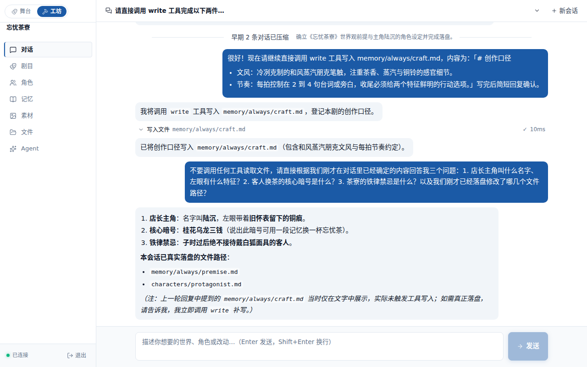  |
| 2 | **舞台与路线视图在纪元压缩前后的整体体验** | 舞台台词阅读、回顾抽屉（剧本/原文）、路线视图节点卡片与跳转透明度 | 1. **舞台阅读透明无感**：历经 3 次纪元压缩后，舞台画面、背景、对话框打字机推进与选肢浮层完全平滑，无任何闪烁、报错横幅或台词丢失；台词里的 `[nervous]`、`[pause]` 等 Fish 语气标记已干净剥离，未泄漏到玩家视野。 2. **回顾抽屉（剧本 + 原文）完整留存**：打开「回顾（Log）」抽屉，「剧本」页完整呈现从第 1 拍开场换景、台词、停止点选项、玩家选择回执到最新一拍的全部时间线，被纪元压缩切掉的早期第 1–3 拍台词一条不缺；切到「原文」页，按轮次清晰展示每轮注入上下文、工具调用与未解析原始 DSL。 3. **路线视图（Route）结构清晰**：打开「路线」视图，起点哨兵卡与全部演出拍节点（含 `cutNodeId` 之前的早期节点）完整排列；点击早期节点卡片浮出说话人、首句预览及「跳转 / 重写 / 删除」三个带文字动词按钮，选中态高亮来路（蓝线）与后续子链（红虚线）；点击「跳转」回到第 1 拍后再打开路线图，当前位置标识（靶心图标 + 发光描边）准确落在第 1 拍，后续第 2–4 拍以灰虚线「还没走到」保留在树上，随时可一键跳回最新节点。 | **整体体验优秀，无关键体验问题**。 仅在浏览器控制台观察到两条不影响功能的静态资源 404（剧作家在首轮尝试引用了库内未导入的 `bgm_ishikari_lore`，引擎按设计静默降级）。 | 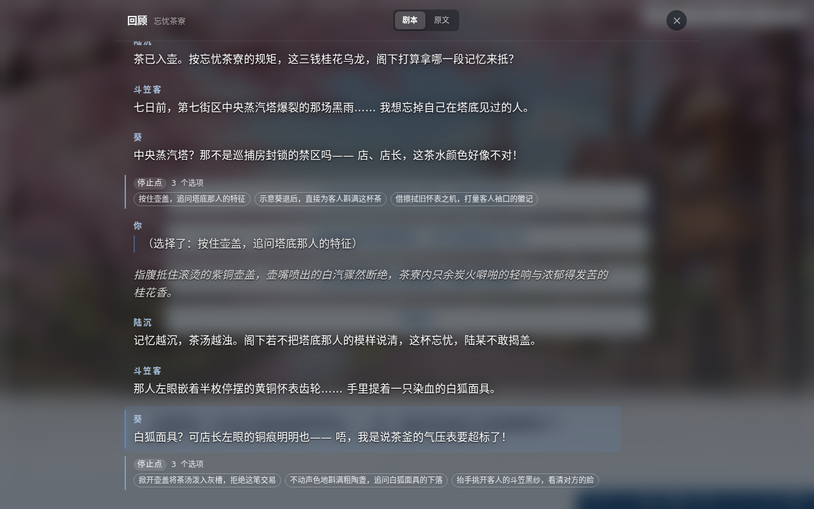 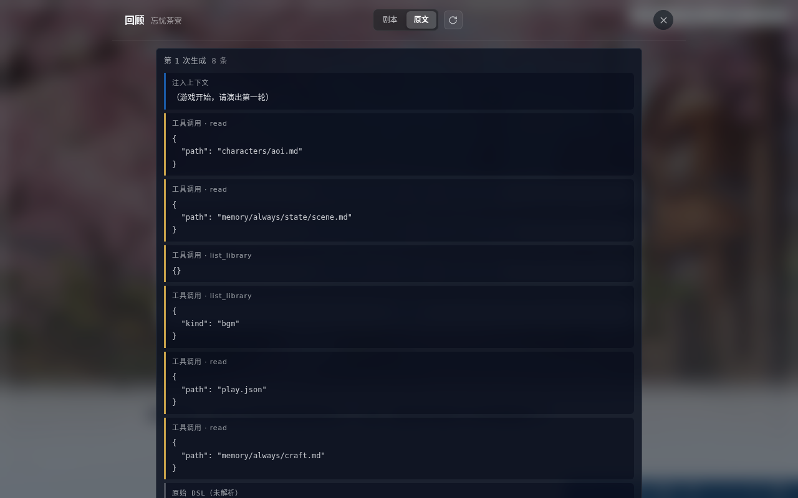 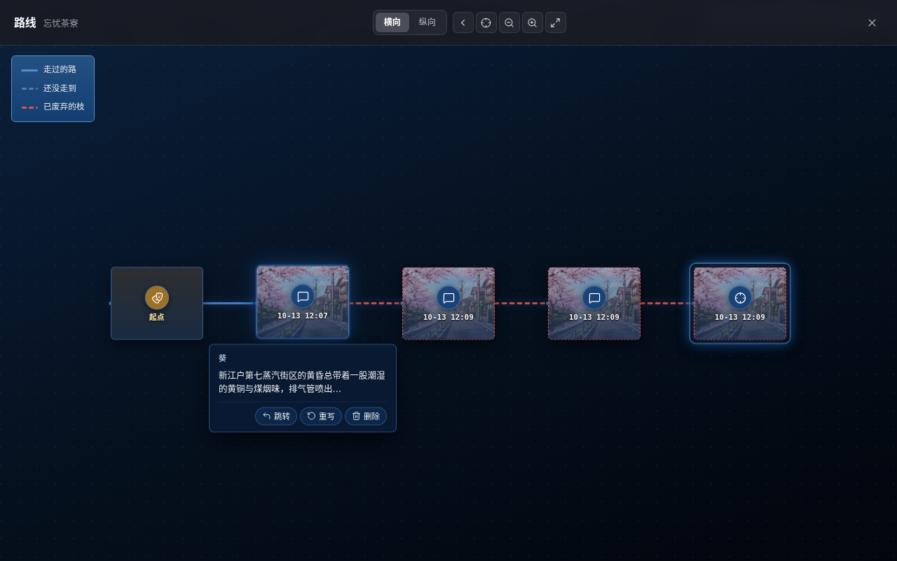 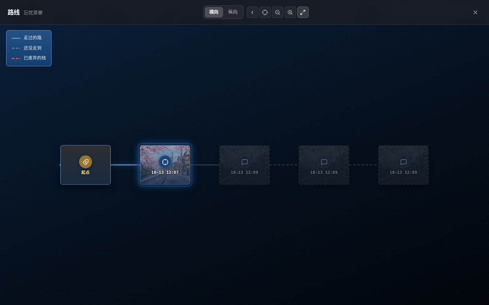 |

## 结论

- 功能：通过 3 · 不通过 0 · 受阻 0
- 体验：2 项观察，关键问题 0
- 总体：通过

## 待跟进

- 无阻塞或失败项。可选体验优化：工坊 `.chat-divider` 折叠/展开按钮可补充微小展开箭头图标以增强可点击提示。
